# Diagrama de Componentes

Este documento define la vista logica de componentes del sistema de gestion de produccion para Inversiones Tecnologicas S.A. (ITECSA). La vista considera los roles RF04, el flujo Kanban con Control de calidad, las reglas de auditoria RNF07/RNF08, Auth0/JWT, Prisma ORM, MySQL, Manager, Postman y MySQL Workbench.

La vista se centra en responsabilidades logicas e interfaces entre componentes. No representa nodos fisicos, procesos en ejecucion, servidores, contenedores ni ubicaciones de ejecucion; esos aspectos se cubren en la vista de despliegue fisico-operacional.

## Sistema de Interes

El sistema de interes es el sistema de gestion de produccion de ITECSA, usado para centralizar el ingreso de pedidos desde Nota de Venta, validacion de pago, preparacion documental, seguimiento productivo, control de calidad, trazabilidad, auditoria, notificaciones, reportes y administracion.

## Interesados y Preocupaciones

| Interesado | Preocupaciones abordadas por esta vista |
| --- | --- |
| Administrador | Configuracion del sistema, roles, permisos, parametros productivos, estados, trazabilidad, auditoria, control de acceso y administracion de usuarios. |
| Ventas | Ingreso de pedidos, datos de Nota de Venta, adjuntos, alertas de sobrecarga y visibilidad del avance productivo. |
| Cobranzas | Confirmacion o rechazo de pago, bloqueo de avance a produccion y trazabilidad de decisiones. |
| Operario | Seguimiento por Kanban, actualizacion de estados y subprocesos, comentarios, control de calidad, adjuntos y documentos asociados. |
| Gerencia | Reportes, indicadores, cumplimiento, carga productiva y visibilidad del proceso. |
| Equipo de desarrollo | Separacion de responsabilidades logicas, dependencias entre componentes, interfaces y correspondencia con tecnologias de implementacion. |
| Administracion tecnica / soporte | Persistencia, auditoria, integraciones externas, datos para operacion, respaldo y herramientas de soporte sin confundirlas con componentes funcionales. |

## Punto de Vista de Componentes

| Elemento | Definicion |
| --- | --- |
| Nombre del punto de vista | Punto de vista logico de componentes. |
| Proposito | Describir los componentes funcionales del sistema, sus responsabilidades, datos principales, colaboraciones, dependencias externas y correspondencia con despliegue. |
| Tipos de modelo usados | Tabla de componentes, tabla de elementos logicos de soporte, tabla de datos manejados, modelo de flujo funcional, tabla de correspondencias y diagrama Mermaid de relaciones logicas. |
| Convenciones | Los nodos del diagrama representan componentes logicos, interfaces internas, persistencias logicas o servicios externos; las tecnologias se documentan como correspondencias de implementacion. |
| Alcance excluido | No describe despliegue fisico, topologia de red, procesos en ejecucion, servidores, contenedores ni herramientas de prueba/administracion como componentes funcionales del sistema. |
| Criterio de completitud | Todo componente funcional debe tener responsabilidad, datos manejados, dependencias, correspondencia de implementacion y correspondencia con despliegue. |

## Vista de Componentes

| N | Componente | Responsabilidades principales | Roles principales |
| --- | --- | --- | --- |
| 1 | Gestion de Usuarios y Roles | Mantener usuarios internos, roles y permisos; relacionar cada usuario interno con `auth0_user_id`; validar JWTs emitidos por Auth0 mediante metadatos/JWKS antes de autorizar modulos, pantallas, botones y puntos de acceso HTTP; controlar acceso segun rol; administrar estado vinculado/desvinculado y firma electronica registrada del usuario. El sistema no almacena contrasenas localmente. | Administrador, todos los usuarios autenticados |
| 2 | Gestion de Pedidos y Nota de Venta | Permitir que Ventas genere pedidos, registre numero de Nota de Venta, consulte Manager por codigo de NV, importe a la persistencia relacional los datos relevantes mediante la capa de acceso a datos, adjunte la NV en PDF, valide duplicidad, registre archivos de diseno y determine si el producto corresponde a lanyard o tarjeta. | Ventas, Administrador |
| 3 | Confirmacion de Cobro | Permitir que Cobranzas actualice el estado de pago desde el detalle del Kanban usando Confirmado, Rechazado y Pendiente; bloquear avance a produccion si el pago no esta confirmado; registrar fecha/hora de servidor y usuario; incorporar la firma electronica registrada del usuario a la NV cuando el pago se confirme. | Cobranzas |
| 4 | Asociacion de Orden de Produccion y Ficha Cliente | Permitir que Administrador adjunte una o mas Ordenes de Produccion y la ficha cliente a la entidad Pedido cuando el pago este confirmado. Mantiene la relacion Pedido-NV-OP-ficha cliente. | Administrador |
| 5 | Kanban y Seguimiento Productivo | Mostrar pedidos en columnas fijas segun estado, abrir detalle del pedido, permitir cambios manuales autorizados por arrastrar y soltar, mostrar subprocesos segun tipo de producto, actualizar subprocesos mediante Stepper, registrar comentarios al cambiar subproceso, aplicar firma electronica en ficha cliente y mostrar etiquetas visuales. | Operario, Administrador, Ventas, Cobranzas, Gerencia |
| 6 | Trazabilidad, Comentarios y Adjuntos | Registrar historial completo de eventos por pedido: cambios de estado, confirmaciones o rechazos de pago, rechazos de control de calidad, comentarios, alertas, adjuntos, firmas electronicas, ingreso bajo sobrecarga, fecha, hora y usuario responsable, sin sobrescribir registros previos. | Todos segun permisos |
| 7 | Capacidad, Plazos y Alertas | Configurar capacidad productiva, calcular carga diaria, alertar sobrecarga desde 90%, calcular fecha estimada de termino por tipo de producto y cantidad, permitir parametros configurables por tipo/rango y registrar pedidos ingresados bajo sobrecarga operativa. | Administrador, Ventas, Operario |
| 8 | Firma Electronica y Documentos Firmados | Almacenar y exponer firma electronica registrada de usuarios; incorporarla a la Nota de Venta al confirmar pago y a la ficha cliente cuando se actualice el estado de un subproceso productivo. Los JWT de Auth0 siguen siendo credenciales firmadas criptograficamente independientes de esta firma electronica de usuario. | Administrador, Cobranzas, Operario |
| 9 | Gestion de Prioridad y Etiquetas Visuales | Administrar etiquetas Urgencia, Atraso y Prioridad; permitir asignacion/remocion de etiquetas; permitir ajuste de prioridad por Administrador u Operario autorizado; entregar datos de prioridad y etiquetas a Kanban, Trazabilidad y Reportes. El calculo de sobrecarga queda en Capacidad, Plazos y Alertas. | Administrador, Operario |
| 10 | Notificaciones | Emitir avisos internos o por correo ante eventos relevantes: nuevo pedido, pago confirmado, pedido urgente, disponibilidad para despacho cuando el pedido llegue a Listo para entrega, rechazo de Nota de Venta y comunicaciones internas. | Ventas, Operario, Administrador, Cobranzas |
| 11 | Reportes e Indicadores | Generar reportes de pedidos por estado, entregas a tiempo/fuera de plazo, carga de produccion, tiempos de ciclo hasta Listo para entrega, ranking de productos, cumplimiento por vendedor incluyendo pedidos bajo sobrecarga y exportaciones Excel/CSV. | Gerencia, Administrador |
| 12 | Administracion del Sistema | Configurar parametros generales: roles, permisos, estados productivos, etiquetas, prioridad, capacidad diaria, rangos de estimacion por tipo de producto/cantidad, reglas de transicion, anuncios internos, parametros de Auth0/JWT que correspondan al sistema y parametros usados por los demas componentes. | Administrador |
| 13 | Auditoria y Bitacora de Seguridad | Registrar eventos auditables con fecha y hora del servidor: intentos de acceso, uso de servicios HTTP protegidos, cambios de estado, confirmaciones de pago, cambios sobre usuarios desactivados, errores relevantes de integracion y eventos operativos que deben conservarse. Mantiene historial inmutable y consultable para cumplimiento RNF07/RNF08. | Administrador, soporte autorizado |

## Elementos Logicos de Soporte e Interfaces

| Elemento | Tipo | Responsabilidad logica | Correspondencia de implementacion |
| --- | --- | --- | --- |
| Interfaz Web | Interfaz de usuario | Presentar vistas, formularios, tablero Kanban, reportes y acciones permitidas por rol. | React, Vite, Bootstrap 5, CSS |
| Interfaz de Servicios HTTP y Controladores | Interfaz de aplicacion | Recibir solicitudes, validar entradas, validar JWT, aplicar autorizacion interna y coordinar casos de uso. | Express, Node.js, JavaScript/TypeScript |
| Acceso a Datos | Componente transversal | Centralizar consultas, modelos, migraciones y transacciones hacia la persistencia relacional. | Prisma ORM |
| Repositorio Relacional | Persistencia logica | Almacenar usuarios, roles, permisos, pedidos, pagos, estados, trazabilidad, auditoria, capacidad, notificaciones, reportes y configuracion. | MySQL |
| Repositorio Documental | Persistencia documental logica | Almacenar NV, OP, fichas cliente, firmas electronicas, adjuntos y archivos de diseno. | Volumen persistente o almacenamiento de objetos definido en despliegue |
| Auth0 | Servicio externo de identidad | Autenticacion, emision de JWT y publicacion de metadatos/JWKS para validacion. | Tenant Auth0 |
| Manager | Sistema externo | Fuente de datos asociados a Nota de Venta y destino/formato de exportacion comercial. | ERP Manager |
| Servicio de Correo | Servicio externo | Envio de notificaciones y mensajes del sistema. | SMTP corporativo o proveedor transaccional |

## Datos que Maneja Cada Componente

Los siguientes datos son logicos y preliminares. No representan todavia el Modelo Entidad-Relacion definitivo ni una estructura fisica de base de datos. La persistencia principal se realiza en el repositorio relacional mediante la capa de acceso a datos, y los binarios se almacenan en el repositorio documental definido por la vista de despliegue.

| N | Componente | Datos que maneja |
| --- | --- | --- |
| 1 | Gestion de Usuarios y Roles | `id_usuario`, `auth0_user_id`, nombre, apellido, RUT, correo unico, rol, estado de cuenta, firma electronica, formato de firma, fecha de creacion, primer inicio de sesion, ultimo acceso, sesiones activas, permisos asociados al rol, claims relevantes del JWT. |
| 2 | Gestion de Pedidos y Nota de Venta | `id_pedido`, `numero_nota_venta`, datos importados desde Manager, archivo PDF de NV, archivos de diseno, fecha de creacion, hora de creacion, razon social, RUT cliente, descripcion de producto, cantidad, datos para fabricacion, tipo de producto, estado del pedido, vendedor responsable. |
| 3 | Confirmacion de Cobro | `id_pedido`, `numero_nota_venta`, estado de pago, usuario de Cobranzas responsable, fecha y hora de servidor de confirmacion o rechazo, firma electronica aplicada al documento, observacion o motivo si corresponde, bloqueo/desbloqueo para produccion. |
| 4 | Asociacion de Orden de Produccion y Ficha Cliente | `id_pedido`, numero de OP, documentos de OP, ficha cliente, fecha de adjunto, usuario que adjunta, relacion Pedido-NV-OP-ficha, estado documental. |
| 5 | Kanban y Seguimiento Productivo | `id_pedido`, estado actual, columna actual, tipo de producto, detalle del pedido, subprocesos por tipo de producto, estado de subproceso, comentarios de subproceso, fecha y hora del ultimo cambio, tiempo en estado actual, etiquetas, prioridad, indicador visual de retraso, motivo de rechazo en control de calidad. |
| 6 | Trazabilidad, Comentarios y Adjuntos | ID de evento, pedido asociado, tipo de evento, estado anterior, estado nuevo, usuario responsable, fecha, hora, comentario, alerta, adjunto, firma electronica, condicion de sobrecarga, metadatos del documento, rechazo de control de calidad. |
| 7 | Capacidad, Plazos y Alertas | tipo de producto, rango de cantidad, capacidad maxima diaria, capacidad utilizada, capacidad disponible, fecha solicitada, fecha estimada de termino, parametros de estimacion, porcentaje de carga, nivel de alerta, indicador de sobrecarga. |
| 8 | Firma Electronica y Documentos Firmados | ID de firma, usuario titular, formato de firma, documento firmado, tipo de documento, fecha y hora de firma, accion que origina la firma, validacion de disponibilidad de firma. |
| 9 | Gestion de Prioridad y Etiquetas Visuales | etiquetas disponibles, etiquetas asignadas, prioridad del pedido, usuario que asigna o remueve, fecha y hora de cambio, condicion de urgencia, condicion de atraso. |
| 10 | Notificaciones | ID de notificacion, usuario destinatario, rol destinatario, tipo de evento, mensaje, fecha, hora, estado de lectura, canal de envio, pedido asociado. |
| 11 | Reportes e Indicadores | rango de fechas, pedidos por estado, pedidos entregados a tiempo, pedidos fuera de plazo, pedidos bajo sobrecarga, tiempos promedio/ciclo, carga de produccion, ranking de productos, cumplimiento por vendedor, formato de exportacion. |
| 12 | Administracion del Sistema | roles, permisos, estados productivos, reglas de transicion, etiquetas, parametros de prioridad, capacidad por tipo de producto, parametros de estimacion por rango, parametros de alertas, anuncios internos, configuracion de firmas, parametros de integracion con Auth0. |
| 13 | Auditoria y Bitacora de Seguridad | ID de evento auditable, tipo de evento, usuario, rol, fecha y hora de servidor, recurso afectado, punto de acceso HTTP, resultado, IP/dispositivo si aplica, referencia a pedido/documento/usuario, estado previo/nuevo, detalle de error, marca de inmutabilidad logica. |

## Modelo de Flujo Funcional de Referencia

El sistema no administra la negociacion previa con el cliente. En esta version, el flujo inicia cuando Ventas genera un pedido desde una Nota de Venta y este queda disponible para validacion de pago y seguimiento productivo.

```text
Pedido generado por Ventas
        |
        v
Codigo de Nota de Venta ingresado
        |
        v
Consulta a Manager y carga/importacion de datos relevantes
        |
        v
Nota de Venta PDF, archivos de diseno y datos del pedido registrados
        |
        v
Confirmacion de pago en detalle del pedido dentro del Kanban
        |
        +-- Pago Pendiente/Rechazado --> No avanza a produccion
        |
        +-- Pago Confirmado --> Firma electronica registrada aplicada a la NV
                                |
                                v
                          Pedido pasa a Listo para produccion
                                |
                                v
                          Administrador adjunta OP y ficha cliente
                                |
                                v
                          Seguimiento productivo por Kanban y subprocesos
                                |
                                v
                          Control de calidad
                                |
                                +-- Rechazado --> vuelve a En produccion con motivo registrado
                                |
                                +-- Aprobado --> Listo para entrega
```

## Columnas Vigentes del Kanban

```text
Confirmacion de pago
        |
        v
Listo para produccion
        |
        v
En produccion
        |
        v
Control de calidad
        |
        v
Listo para entrega
```

## Subprocesos Productivos por Tipo de Producto

| Tipo de producto | Subprocesos |
| --- | --- |
| Lanyard | Impresion, sublimacion, corte, costura, control de calidad |
| Tarjeta | Revisar informacion, ordenar informacion, cargar datos, control de calidad |

Cada subproceso se actualiza mediante Stepper interactivo por usuario autorizado. Al cambiar un subproceso, el sistema debe permitir comentario y agregar la firma electronica del usuario a la ficha cliente. Si un pedido es rechazado en Control de calidad, debe registrarse motivo, fecha, hora y usuario, y el pedido vuelve a En produccion.

## Relaciones entre Componentes

```text
Interfaz Web
        -> presenta vistas y formularios del sistema
        -> consume los servicios HTTP mediante solicitudes controladas

Interfaz de Servicios HTTP y Controladores
        -> recibe solicitudes de la Interfaz Web
        -> valida entradas y JWT antes de invocar componentes protegidos
        -> registra eventos de acceso en Auditoria y Bitacora de Seguridad
        -> expone operaciones para los componentes funcionales

Gestion de Usuarios y Roles
        -> valida el JWT recibido desde la Interfaz de Servicios HTTP y Controladores usando metadatos/JWKS de Auth0
        -> relaciona auth0_user_id con el usuario interno
        -> entrega permisos por rol para todos los componentes
        -> entrega firma electronica a Firma Electronica y Documentos Firmados
        -> registra intentos y cambios de usuario en Auditoria y Bitacora de Seguridad

Gestion de Pedidos y Nota de Venta
        -> crea Pedido
        -> consulta Manager usando el codigo de NV ingresado por Ventas
        -> importa a la persistencia relacional los datos relevantes de la NV mediante Acceso a Datos
        -> adjunta NV y archivos de diseno mediante Repositorio Documental
        -> valida duplicidad de numero de NV
        -> envia Pedido a Confirmacion de Cobro
        -> entrega datos a Capacidad, Plazos y Alertas

Confirmacion de Cobro
        -> consulta permisos en Gestion de Usuarios y Roles
        -> incorpora firma electronica mediante Firma Electronica y Documentos Firmados
        -> desbloquea avance a Listo para produccion
        -> registra evento en Trazabilidad y Auditoria

Asociacion de Orden de Produccion y Ficha Cliente
        -> adjunta OP y ficha cliente al Pedido
        -> persiste documentos en Repositorio Documental
        -> registra documentos en Trazabilidad
        -> habilita detalle documental para Kanban

Kanban y Seguimiento Productivo
        -> muestra Pedido por estado
        -> actualiza estados y subprocesos
        -> gestiona Control de calidad y reproceso por rechazo
        -> usa Gestion de Prioridad y Etiquetas Visuales para etiquetas/prioridad
        -> usa Firma Electronica y Documentos Firmados al actualizar subprocesos
        -> registra eventos en Trazabilidad y Auditoria
        -> dispara Notificaciones segun eventos

Capacidad, Plazos y Alertas
        -> calcula carga y fechas estimadas
        -> informa alertas a Ventas y Administrador
        -> registra sobrecarga en Trazabilidad
        -> alimenta Reportes e Indicadores

Gestion de Prioridad y Etiquetas Visuales
        -> administra etiquetas y prioridad
        -> actualiza visualizacion del Kanban
        -> alimenta Reportes e Indicadores

Notificaciones
        -> recibe eventos desde Pedido, Pago, Kanban y Capacidad
        -> envia avisos internos o por correo

Reportes e Indicadores
        -> consume datos desde Trazabilidad, Auditoria, Kanban, Capacidad y Prioridad
        -> entrega panel gerencial y exportaciones

Administracion del Sistema
        -> configura roles, permisos, estados, capacidad, parametros de estimacion, etiquetas y anuncios
        -> registra cambios administrativos en Auditoria

Auditoria y Bitacora de Seguridad
        -> registra eventos con fecha y hora del servidor
        -> conserva eventos asociados a usuarios desactivados
        -> alimenta Reportes e Indicadores cuando se requiera evidencia historica

Acceso a Datos
        -> centraliza consultas, modelos y transacciones hacia el repositorio relacional

Repositorio Relacional
        -> almacena usuarios internos, pedidos, pagos, trazabilidad, auditoria, capacidad, notificaciones, reportes y configuracion

Repositorio Documental
        -> almacena NV, OP, fichas cliente, firmas electronicas, adjuntos y archivos de diseno
```

## Correspondencias de Implementacion

| Elemento logico | Tecnologia o soporte asociado | Criterio de correspondencia |
| --- | --- | --- |
| Interfaz Web | React, Vite, Bootstrap 5, CSS | Implementa la presentacion y consume los servicios HTTP del sistema. |
| Interfaz de Servicios HTTP y Controladores | Node.js, Express, JavaScript/TypeScript | Gestiona solicitudes HTTP, validaciones de entrada, validacion de JWT y coordinacion de casos de uso. |
| Componentes funcionales | Node.js, JavaScript/TypeScript | Ejecutan reglas de negocio, autorizacion interna, trazabilidad, auditoria y coordinacion de casos de uso. |
| Gestion de Usuarios y Roles | Auth0, JWT, claims, `auth0_user_id` | Delega autenticacion a Auth0 y mantiene autorizacion interna por roles y permisos. |
| Auditoria y Bitacora de Seguridad | Node.js, MySQL, registros de aplicacion | Registra eventos con fecha/hora del servidor y conserva historial exigido por RNF07/RNF08. |
| Acceso a Datos | Prisma ORM | Mapea modelos de aplicacion y centraliza consultas/transacciones hacia MySQL. |
| Repositorio Relacional | MySQL | Persistencia relacional principal del sistema. |
| Repositorio Documental | Volumen persistente o almacenamiento de objetos | Persistencia de documentos y binarios que no deben mezclarse con la estructura relacional principal. |
| Administracion tecnica de datos | MySQL Workbench | Herramienta de modelado y administracion; no es componente en ejecucion del sistema. |
| Pruebas de servicios HTTP | Postman | Herramienta de pruebas, validacion y monitoreo durante desarrollo; no es componente en ejecucion del sistema. |
| Monitoreo operativo | Consola del servidor, registros de aplicacion, revision de almacenamiento | Soporte operacional para disponibilidad y diagnostico; no ejecuta responsabilidades funcionales del sistema. |
| Respaldo operacional | Tareas programadas, copias de seguridad o herramienta administrada | Protege MySQL y Repositorio Documental; corresponde a la vista de despliegue. |
| Servicios externos | Auth0, Manager, Servicio de Correo | Servicios fuera del limite funcional del sistema propio, consumidos por componentes internos. |

## Tecnologia de Soporte y Servicios Considerados

| Tecnologia o servicio | Uso dentro del sistema |
| --- | --- |
| Auth0 | Autenticacion de usuarios, emision de JWTs, manejo de identidad y publicacion de metadatos/JWKS para validacion. |
| MySQL | Base de datos relacional principal para usuarios internos, pedidos, pagos, trazabilidad, auditoria, capacidad, notificaciones, reportes y configuracion. |
| Prisma ORM | Capa de acceso a datos y mapeo entre la aplicacion Node.js/JavaScript y MySQL. Centraliza consultas, modelos y transacciones. |
| Servicio de Correo | Envio de correos generados por Notificaciones y recuperacion de contrasena si no queda cubierta por Auth0. |
| Manager | Fuente externa de datos de Nota de Venta. Cuando Ventas ingresa el codigo de NV, el sistema ejecuta una consulta para obtener/exportar los datos relevantes de esa NV y luego los importa a la persistencia propia mediante Acceso a Datos. |
| Postman | Herramienta de soporte para pruebas de servicios HTTP; no forma parte de la arquitectura de ejecucion. |
| MySQL Workbench | Herramienta de administracion/modelado de base de datos; no forma parte de la arquitectura de ejecucion. |
| Monitoreo basico / registros | Herramientas de apoyo para revisar errores, eventos operativos, espacio disponible y disponibilidad; no son componentes funcionales. |
| Respaldo | Soporte operacional para recuperar datos y documentos ante incidentes; se representa fisicamente en despliegue. |

## Reglas de Correspondencia y Consistencia

| Regla | Criterio de consistencia |
| --- | --- |
| Separacion de responsabilidades | Cada componente funcional debe mantener una responsabilidad principal identificable y no asumir responsabilidades de otro componente de la tabla principal. |
| Acceso protegido | Toda operacion protegida debe pasar por la Interfaz de Servicios HTTP y Controladores, validar JWT y consultar Gestion de Usuarios y Roles para autorizacion interna. |
| Roles formales | Los roles de sistema son Administrador, Gerencia, Operario, Ventas y Cobranzas. Diseno se trata como area organizacional/documental, no como rol formal del sistema. |
| Persistencia relacional | Los componentes funcionales no acceden directamente al repositorio relacional; usan Acceso a Datos como dependencia transversal. |
| Persistencia documental | Los documentos, firmas, adjuntos y archivos de diseno se gestionan mediante Repositorio Documental y deben tener correspondencia en despliegue. |
| Auditoria | Los eventos de seguridad, cambios de estado, confirmaciones de pago y acciones de usuarios desactivados deben registrarse con fecha/hora del servidor y conservarse sin sobrescritura. |
| Servicios externos | Auth0, Manager y Servicio de Correo se modelan como servicios externos, no como componentes funcionales propios de ITECSA. |
| Herramientas de soporte | Postman, MySQL Workbench, monitoreo y respaldos no aparecen como componentes funcionales en el diagrama Mermaid porque no ejecutan responsabilidades de negocio; corresponden a soporte tecnico y operativo. |
| Consistencia con despliegue | Interfaz Web se despliega como artefacto web estatico, componentes funcionales e interfaz de servicios HTTP se ejecutan en el proceso de aplicacion Node.js, Repositorio Relacional corresponde a MySQL y Repositorio Documental corresponde al almacenamiento persistente de archivos. |

## Diagrama Mermaid

```mermaid
flowchart TD
    subgraph Presentacion["Vista de Interaccion"]
        Web["Interfaz Web"]
    end

    subgraph Entrada["Interfaces de Aplicacion"]
        ServiciosHTTP["Interfaz de Servicios HTTP y Controladores"]
    end

    subgraph Seguridad["Seguridad, Acceso y Auditoria"]
        Usuarios["Gestion de Usuarios y Roles"]
        Auditoria["Auditoria y Bitacora de Seguridad"]
    end

    subgraph Funcionales["Componentes Funcionales"]
        Pedidos["Gestion de Pedidos y Nota de Venta"]
        Cobro["Confirmacion de Cobro"]
        OPFicha["Asociacion de OP y Ficha Cliente"]
        Kanban["Kanban y Seguimiento Productivo"]
        Trazabilidad["Trazabilidad, Comentarios y Adjuntos"]
        Capacidad["Capacidad, Plazos y Alertas"]
        Firma["Firma Electronica y Documentos Firmados"]
        Prioridad["Gestion de Prioridad y Etiquetas Visuales"]
        Notificaciones["Notificaciones"]
        Reportes["Reportes e Indicadores"]
        Admin["Administracion del Sistema"]
    end

    subgraph Persistencia["Persistencia Logica"]
        AccesoDatos["Acceso a Datos"]
        Repositorio["Repositorio Relacional"]
        RepoDocs["Repositorio Documental"]
    end

    subgraph Externos["Servicios Externos"]
        Auth0["Auth0"]
        Manager["Manager"]
        Correo["Servicio de Correo"]
    end

    Web -->|"consume operaciones"| ServiciosHTTP
    ServiciosHTTP -->|"valida entrada y credencial JWT"| Usuarios
    ServiciosHTTP -->|"registra eventos de acceso"| Auditoria
    Auth0 -->|"emite JWTs"| Web
    ServiciosHTTP -->|"consulta metadatos/JWKS"| Auth0

    Usuarios -->|"autoriza por rol"| Pedidos
    Usuarios -->|"autoriza por rol"| Cobro
    Usuarios -->|"autoriza por rol"| Kanban
    Usuarios -->|"firma asociada"| Firma
    Usuarios -->|"eventos de seguridad"| Auditoria

    ServiciosHTTP -->|"invoca casos de uso"| Pedidos
    ServiciosHTTP -->|"invoca casos de uso"| Cobro
    ServiciosHTTP -->|"invoca casos de uso"| Kanban
    ServiciosHTTP -->|"invoca casos de uso"| Reportes
    ServiciosHTTP -->|"invoca configuracion"| Admin

    Pedidos -->|"consulta codigo NV"| Manager
    Manager -->|"entrega datos relevantes de NV"| Pedidos
    Pedidos -->|"pedido pendiente de pago"| Cobro
    Pedidos -->|"datos de producto y cantidad"| Capacidad
    Pedidos -->|"NV y archivos de diseno"| RepoDocs

    Cobro -->|"firma electronica en NV"| Firma
    Cobro -->|"habilita avance"| OPFicha
    Cobro -->|"evento de pago"| Trazabilidad
    Cobro -->|"evento auditable"| Auditoria

    OPFicha -->|"adjunta OP y ficha cliente"| Kanban
    OPFicha -->|"documentos asociados"| Trazabilidad
    OPFicha -->|"OP y ficha cliente"| RepoDocs

    Kanban -->|"cambios de estado, subprocesos y control de calidad"| Trazabilidad
    Kanban -->|"usa etiquetas y prioridad"| Prioridad
    Kanban -->|"solicita firma en subproceso"| Firma
    Kanban -->|"eventos de seguimiento"| Notificaciones
    Kanban -->|"estado de pedidos"| Reportes
    Kanban -->|"eventos auditables"| Auditoria

    Capacidad -->|"alertas y fechas estimadas"| Kanban
    Capacidad -->|"sobrecarga registrada"| Trazabilidad
    Capacidad -->|"carga productiva"| Reportes

    Prioridad -->|"prioridad y etiquetas"| Kanban
    Prioridad -->|"datos de prioridad"| Reportes

    Trazabilidad -->|"historial consolidado"| Reportes
    Trazabilidad -->|"eventos auditables"| Auditoria
    Firma -->|"documentos firmados"| RepoDocs
    Notificaciones -->|"envia correos"| Correo
    Admin -->|"configura reglas y parametros"| Usuarios
    Admin -->|"configura capacidad"| Capacidad
    Admin -->|"configura etiquetas"| Prioridad
    Admin -->|"configura estados"| Kanban
    Admin -->|"cambios administrativos"| Auditoria
    Auditoria -->|"datos auditables"| Reportes

    Usuarios --> AccesoDatos
    Pedidos --> AccesoDatos
    Cobro --> AccesoDatos
    OPFicha --> AccesoDatos
    Kanban --> AccesoDatos
    Trazabilidad --> AccesoDatos
    Capacidad --> AccesoDatos
    Firma --> AccesoDatos
    Prioridad --> AccesoDatos
    Notificaciones --> AccesoDatos
    Reportes --> AccesoDatos
    Admin --> AccesoDatos
    Auditoria --> AccesoDatos
    AccesoDatos --> Repositorio
```



## Correspondencia con Despliegue

| Elemento logico | Nodo/artefacto esperado en despliegue | Criterio |
| --- | --- | --- |
| Interfaz Web | Navegador web moderno + artefacto web estatico React/Vite | La interfaz se sirve como artefacto web estatico y se ejecuta en dispositivos cliente. |
| Interfaz de Servicios HTTP y Controladores | Proceso de aplicacion Node.js detras del proxy HTTPS | Expone servicios HTTP, valida solicitudes y coordina componentes funcionales. |
| Componentes funcionales 1-13 | Proceso de aplicacion Node.js | Ejecuta reglas de negocio, autorizacion, auditoria, trazabilidad, reportes e integraciones. |
| Acceso a Datos | Prisma ORM dentro del proceso Node.js | Centraliza consultas, migraciones y transacciones. |
| Repositorio Relacional | Instancia MySQL | Persiste datos estructurados y bitacoras. |
| Repositorio Documental | Repositorio persistente de archivos | Persiste NV, OP, fichas, firmas electronicas, adjuntos y archivos de diseno. |
| Auth0 | Tenant externo Auth0 | Autentica usuarios y emite JWT. |
| Manager | Manager / ERP externo | Entrega datos de NV y soporta formato comercial. |
| Servicio de Correo | Servicio externo de correo | Entrega notificaciones generadas por el sistema. |
| Herramientas de soporte | Postman, MySQL Workbench, monitoreo/registros y respaldos | Apoyan desarrollo, administracion y operacion; no son componentes funcionales. |

## Justificacion Arquitectonica

- La separacion entre componentes funcionales, interfaces de aplicacion, seguridad, auditoria, persistencia logica y servicios externos permite describir responsabilidades del sistema sin mezclar nodos fisicos.
- Las tecnologias React, Vite, Express, Node.js, Prisma ORM y MySQL corresponden a implementacion y soporte tecnico, por lo que no se representan como componentes funcionales independientes.
- Auth0 se modela como servicio externo de identidad porque autentica usuarios y emite JWTs; Gestion de Usuarios y Roles conserva la responsabilidad interna de autorizacion por rol y relacion con `auth0_user_id`.
- Auditoria y Bitacora de Seguridad es un componente logico porque RNF07 y RNF08 requieren conservar eventos con fecha/hora de servidor e historial de acciones asociadas a usuarios desactivados.
- Repositorio Documental concentra archivos binarios, firmas, NV, OP, fichas y archivos de diseno para mantenerlos separados del modelo relacional principal.
- Control de calidad forma parte del flujo Kanban porque el Documento 0 lo define como estado del proceso e incluye casos de uso de rechazo, reproceso e historial.
- Postman, MySQL Workbench, monitoreo y respaldos corresponden a soporte tecnico-operativo. No ejecutan responsabilidades funcionales, por lo que se tratan como herramientas de soporte.

## Justificacion de Herramientas Operativas

Postman y MySQL Workbench forman parte del soporte tecnico descrito para el proyecto. En la vista de componentes se tratan como herramientas de apoyo para preservar la separacion de niveles: Postman prueba servicios HTTP, MySQL Workbench administra/modela datos, monitoreo/registros apoyan diagnostico y respaldos protegen continuidad, pero ninguno implementa reglas funcionales del sistema de ITECSA.
