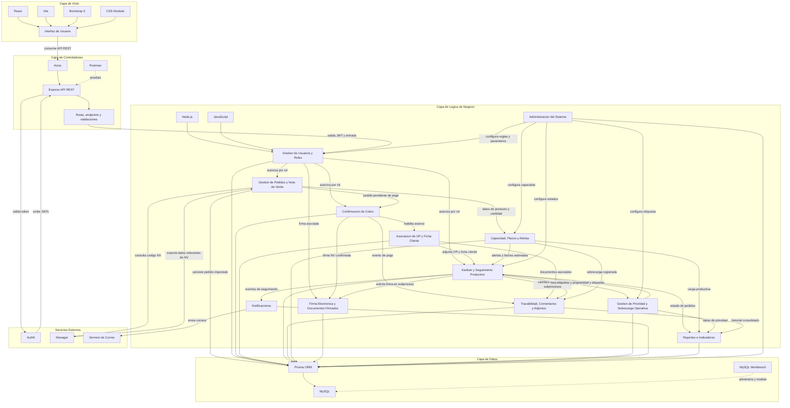

# Diagrama de Componentes

Este documento define la version definitiva del diagrama textual de componentes para el sistema de gestion de produccion de ITECSA. El flujo funcional se organiza alrededor de la entidad Pedido, desde el ingreso de la Nota de Venta hasta el seguimiento productivo, notificaciones, trazabilidad, reportes y administracion del sistema.

La arquitectura tecnica se compone de una capa de vista construida con React, Vite, Bootstrap 5 y CSS Modular; una capa de controladores basada en Express, Axios y Postman; una capa de logica de negocio con Node.js, JavaScript y Auth0; y una capa de datos con MySQL, Prisma ORM y MySQL Workbench.

| N | Componente | Responsabilidades principales | Roles principales |
| --- | --- | --- | --- |
| 1 | Gestion de Usuarios y Roles | Mantener usuarios internos, roles y permisos; relacionar cada usuario interno con `auth0_user_id`; validar JWTs emitidos por Auth0 antes de autorizar modulos, pantallas, botones y endpoints; controlar acceso segun rol; administrar estado vinculado/desvinculado y firma electronica asociada al usuario. El sistema no almacena contrasenas localmente. | Administrador, todos los usuarios autenticados |
| 2 | Gestion de Pedidos y Nota de Venta | Permitir que Ventas genere pedidos, registre numero de Nota de Venta, consulte Manager por codigo de NV, importe a MySQL los datos relevantes mediante Prisma ORM, adjunte la NV en formato PDF, valide duplicidad e identifique si el producto corresponde a lanyard o tarjeta. | Ventas, Administrador |
| 3 | Confirmacion de Cobro | Permitir que Cobranzas actualice el estado de pago del pedido desde el detalle del Kanban usando los estados Confirmado, Rechazado y Pendiente; bloquear el avance a produccion si el pago no esta confirmado; registrar fecha, hora y usuario; solicitar firma digital de la NV cuando el pago se confirme. | Cobranzas |
| 4 | Asociacion de Orden de Produccion y Ficha Cliente | Permitir que Administrador adjunte la o las Ordenes de Produccion y la ficha cliente a la entidad Pedido cuando el pago este confirmado. Mantiene la relacion Pedido-NV-OP-ficha cliente. | Administrador |
| 5 | Kanban y Seguimiento Productivo | Mostrar pedidos en columnas fijas segun estado, abrir detalle del pedido, permitir cambios manuales autorizados por arrastrar y soltar, mostrar subprocesos segun tipo de producto, actualizar subprocesos mediante Stepper, registrar comentarios al cambiar subproceso, aplicar firma electronica en ficha cliente y mostrar etiquetas visuales. | Produccion/Operario, Administrador, Ventas, Cobranzas, Gerencia |
| 6 | Trazabilidad, Comentarios y Adjuntos | Registrar historial completo de eventos por pedido: cambios de estado, confirmaciones o rechazos de pago, comentarios, alertas, adjuntos, firmas, ingreso bajo sobrecarga, fecha, hora y usuario responsable, sin sobrescribir registros previos. | Todos segun permisos |
| 7 | Capacidad, Plazos y Alertas | Configurar capacidad productiva, calcular carga diaria, alertar sobrecarga desde 90%, calcular fecha estimada de termino por tipo de producto y cantidad, permitir parametros configurables por tipo/rango y registrar pedidos ingresados bajo sobrecarga operativa. | Administrador, Ventas, Produccion |
| 8 | Firma Electronica y Documentos Firmados | Almacenar y exponer firma electronica de usuarios, firmar digitalmente la Nota de Venta al confirmar pago y agregar la firma electronica del usuario a la ficha cliente cuando se actualice el estado de un subproceso productivo. | Administrador, Cobranzas, Operario |
| 9 | Gestion de Prioridad y Sobrecarga Operativa | Administrar etiquetas Urgencia, Atraso y Prioridad, permitir asignacion/remocion de etiquetas, permitir ajuste de prioridad por Administrador y entregar datos de prioridad/sobrecarga a Kanban, Trazabilidad y Reportes. | Administrador, Operario, Produccion |
| 10 | Notificaciones | Emitir avisos internos o por correo ante eventos relevantes: nuevo pedido, pago confirmado, pedido urgente, disponibilidad para despacho cuando el pedido llegue a Listo para entrega y comunicaciones internas. | Ventas, Produccion, Administrador, Cobranzas |
| 11 | Reportes e Indicadores | Generar reportes de pedidos por estado, entregas a tiempo/fuera de plazo, carga de produccion, tiempos de ciclo hasta Listo para entrega, ranking de productos, cumplimiento por vendedor incluyendo pedidos bajo sobrecarga y exportaciones Excel/CSV. | Gerencia, Administrador |
| 12 | Administracion del Sistema | Configurar parametros generales: roles, permisos, estados productivos, etiquetas, prioridad, capacidad diaria, rangos de estimacion por tipo de producto/cantidad, reglas de transicion, anuncios internos, parametros de Auth0/JWT que correspondan al sistema y parametros usados por los demas componentes. | Administrador |

## Datos que Maneja Cada Componente

Los siguientes datos son logicos y preliminares. No representan todavia el Modelo Entidad-Relacion definitivo ni una estructura fisica de base de datos. La persistencia principal se realiza en MySQL mediante Prisma ORM.

| N | Componente | Datos que maneja |
| --- | --- | --- |
| 1 | Gestion de Usuarios y Roles | `id_usuario`, `auth0_user_id`, nombre, apellido, RUT, correo unico, rol, estado de cuenta, firma electronica, formato de firma, fecha de creacion, primer inicio de sesion, ultimo acceso, sesiones activas, permisos asociados al rol, claims relevantes del JWT. |
| 2 | Gestion de Pedidos y Nota de Venta | `id_pedido`, `numero_nota_venta`, datos importados desde Manager, archivo PDF de NV, fecha de creacion, hora de creacion, razon social, RUT cliente, descripcion de producto, cantidad, datos para fabricacion, tipo de producto, estado del pedido, vendedor responsable. |
| 3 | Confirmacion de Cobro | `id_pedido`, `numero_nota_venta`, estado de pago, usuario de Cobranzas responsable, fecha y hora de confirmacion o rechazo, firma digital aplicada, observacion o motivo si corresponde, bloqueo/desbloqueo para produccion. |
| 4 | Asociacion de Orden de Produccion y Ficha Cliente | `id_pedido`, numero de OP, documentos de OP, ficha cliente, fecha de adjunto, usuario que adjunta, relacion Pedido-NV-OP-ficha, estado documental. |
| 5 | Kanban y Seguimiento Productivo | `id_pedido`, estado actual, columna actual, tipo de producto, detalle del pedido, subprocesos por tipo de producto, estado de subproceso, comentarios de subproceso, fecha y hora del ultimo cambio, tiempo en estado actual, etiquetas, prioridad, indicador visual de retraso. |
| 6 | Trazabilidad, Comentarios y Adjuntos | ID de evento, pedido asociado, tipo de evento, estado anterior, estado nuevo, usuario responsable, fecha, hora, comentario, alerta, adjunto, firma, condicion de sobrecarga, metadatos del documento. |
| 7 | Capacidad, Plazos y Alertas | tipo de producto, rango de cantidad, capacidad maxima diaria, capacidad utilizada, capacidad disponible, fecha solicitada, fecha estimada de termino, parametros de estimacion, porcentaje de carga, nivel de alerta, indicador de sobrecarga. |
| 8 | Firma Electronica y Documentos Firmados | ID de firma, usuario titular, formato de firma, documento firmado, tipo de documento, fecha y hora de firma, accion que origina la firma, validacion de disponibilidad de firma. |
| 9 | Gestion de Prioridad y Sobrecarga Operativa | etiquetas disponibles, etiquetas asignadas, prioridad del pedido, usuario que asigna o remueve, fecha y hora de cambio, condicion de urgencia, condicion de atraso, condicion de sobrecarga. |
| 10 | Notificaciones | ID de notificacion, usuario destinatario, rol destinatario, tipo de evento, mensaje, fecha, hora, estado de lectura, canal de envio, pedido asociado. |
| 11 | Reportes e Indicadores | rango de fechas, pedidos por estado, pedidos entregados a tiempo, pedidos fuera de plazo, pedidos bajo sobrecarga, tiempos promedio/ciclo, carga de produccion, ranking de productos, cumplimiento por vendedor, formato de exportacion. |
| 12 | Administracion del Sistema | roles, permisos, estados productivos, reglas de transicion, etiquetas, parametros de prioridad, capacidad por tipo de producto, parametros de estimacion por rango, parametros de alertas, anuncios internos, configuracion de firmas, parametros de integracion con Auth0. |

## Regla de Inicio y Avance del Flujo

El sistema no administra la negociacion previa con el cliente. En esta version, el flujo inicia cuando Ventas genera un pedido desde una Nota de Venta y este queda disponible para validacion de pago y seguimiento productivo.

```text
Pedido generado por Ventas
        |
        v
Codigo de Nota de Venta ingresado
        |
        v
Consulta a Manager y carga/importacion de datos relevantes
        |
        v
Nota de Venta PDF asociada y datos del pedido registrados
        |
        v
Confirmacion de pago en detalle del pedido dentro del Kanban
        |
        +-- Pago Pendiente/Rechazado --> No avanza a produccion
        |
        +-- Pago Confirmado --> Se firma digitalmente la NV
                                |
                                v
                          Pedido pasa a Listo para produccion
                                |
                                v
                          Administrador adjunta OP y ficha cliente
                                |
                                v
                          Seguimiento productivo por Kanban y subprocesos
```

## Columnas Vigentes del Kanban

```text
Confirmacion de pago
        |
        v
Listo para produccion
        |
        v
En produccion
        |
        v
Listo para entrega
```

## Subprocesos Productivos por Tipo de Producto

| Tipo de producto | Subprocesos |
| --- | --- |
| Lanyard | Impresion, sublimacion, corte, costura |
| Tarjeta | Revisar informacion, ordenar informacion, cargar datos |

Cada subproceso se actualiza mediante Stepper interactivo por usuario autorizado. Al cambiar un subproceso, el sistema debe permitir comentario y agregar la firma electronica del usuario a la ficha cliente.

## Relaciones entre Componentes

```text
React/Vite/Bootstrap/CSS Modular
        -> renderiza la interfaz de usuario y consume la API REST mediante Axios

Express
        -> expone rutas y endpoints
        -> valida entradas
        -> exige JWT valido antes de invocar logica protegida

Auth0
        -> autentica usuarios
        -> emite JWTs
        -> permite validar identidad y sesion

Gestion de Usuarios y Roles
        -> valida el JWT recibido desde la capa de controladores
        -> relaciona auth0_user_id con el usuario interno
        -> entrega permisos por rol para todos los componentes
        -> entrega firma electronica a Firma Electronica y Documentos Firmados

Gestion de Pedidos y Nota de Venta
        -> crea Pedido
        -> consulta Manager usando el codigo de NV ingresado por Ventas
        -> importa a MySQL los datos relevantes de la NV mediante Prisma ORM
        -> valida duplicidad de numero de NV
        -> envia Pedido a Confirmacion de Cobro
        -> entrega datos a Capacidad, Plazos y Alertas

Confirmacion de Cobro
        -> consulta permisos en Gestion de Usuarios y Roles
        -> firma NV mediante Firma Electronica y Documentos Firmados
        -> desbloquea avance a Listo para produccion
        -> registra evento en Trazabilidad

Asociacion de Orden de Produccion y Ficha Cliente
        -> adjunta OP y ficha cliente al Pedido
        -> registra documentos en Trazabilidad
        -> habilita detalle documental para Kanban

Kanban y Seguimiento Productivo
        -> muestra Pedido por estado
        -> actualiza estados y subprocesos
        -> usa Gestion de Prioridad y Sobrecarga Operativa para etiquetas/prioridad
        -> usa Firma Electronica y Documentos Firmados al actualizar subprocesos
        -> registra eventos en Trazabilidad
        -> dispara Notificaciones segun eventos

Capacidad, Plazos y Alertas
        -> calcula carga y fechas estimadas
        -> informa alertas a Ventas y Administrador
        -> registra sobrecarga en Trazabilidad
        -> alimenta Reportes e Indicadores

Gestion de Prioridad y Sobrecarga Operativa
        -> administra etiquetas y prioridad
        -> actualiza visualizacion del Kanban
        -> alimenta Reportes e Indicadores

Notificaciones
        -> recibe eventos desde Pedido, Pago, Kanban y Capacidad
        -> envia avisos internos o por correo

Reportes e Indicadores
        -> consume datos desde Trazabilidad, Kanban, Capacidad y Prioridad
        -> entrega panel gerencial y exportaciones

Administracion del Sistema
        -> configura roles, permisos, estados, capacidad, parametros de estimacion, etiquetas y anuncios

Prisma ORM
        -> mapea modelos de aplicacion a MySQL
        -> centraliza consultas y transacciones de persistencia

MySQL
        -> almacena usuarios internos, pedidos, pagos, documentos, trazabilidad, capacidad, notificaciones, reportes y configuracion
```

## Capas Tecnicas del Sistema

| Capa | Descripcion | Tecnologias | Funciones |
| --- | --- | --- | --- |
| Capa de Vista | Interfaz de Usuario | React, Vite, Bootstrap 5, CSS Modular | Interfaz de usuario, componentes dinamicos, estilos modulares |
| Capa de Controladores | Gestion de solicitudes y comunicacion | Express, Axios, Postman | Rutas/endpoints, validaciones de entrada, comunicacion API REST |
| Capa de Logica de Negocio | Procesamiento de reglas, autenticacion y control de acceso | Node.js, JavaScript, Auth0 | Autenticacion con Auth0, validacion de JWTs, control de acceso por roles, reglas de negocio, manejo de sesiones |
| Capa de Datos | Almacenamiento y gestion de informacion | MySQL, Prisma ORM, MySQL Workbench | Consultas y transacciones, modelado de datos, administracion de base de datos |

Notas:

- Postman se considera herramienta de soporte para pruebas de endpoints, no componente runtime central.
- MySQL Workbench se considera herramienta de administracion/modelado de base de datos, no componente runtime central.
- Prisma ORM se considera dependencia transversal de persistencia, no componente funcional de negocio.
- La autenticacion no guarda contrasenas localmente; se delega a Auth0. El sistema consume y valida JWTs para decidir autorizacion interna segun roles y permisos.

## Tecnologia de Soporte y Servicios Considerados

| Tecnologia o servicio | Uso dentro del sistema |
| --- | --- |
| Auth0 | Autenticacion de usuarios, emision y validacion de JWTs, manejo de identidad y recuperacion de acceso si queda configurada en el proveedor. |
| MySQL | Base de datos relacional principal para usuarios internos, pedidos, pagos, documentos, Kanban, trazabilidad, capacidad, notificaciones, reportes y configuracion. |
| Prisma ORM | Capa de acceso a datos y mapeo entre la aplicacion Node.js/JavaScript y MySQL. Centraliza consultas, modelos y transacciones. |
| Servicio de Correo | Envio de correos generados por Notificaciones y recuperacion de contrasena si no queda cubierta por Auth0. |
| Manager | Fuente externa de datos de Nota de Venta. Cuando Ventas ingresa el codigo de NV, el sistema ejecuta una consulta para obtener/exportar los datos relevantes de esa NV y luego los importa a la base de datos propia en MySQL mediante Prisma ORM. |

## Diagrama Mermaid


