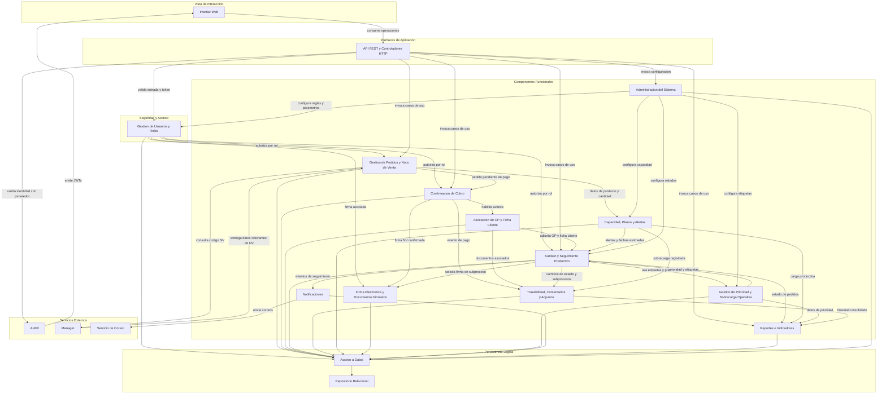

# Diagrama de Componentes

Este documento define la vista logica de componentes para el sistema de gestion de produccion de ITECSA. La descripcion se organiza como una descripcion arquitectonica alineada con ISO/IEC/IEEE 42010: identifica el sistema de interes, los interesados, sus preocupaciones, el punto de vista usado, la vista de componentes, las correspondencias y la justificacion de las decisiones tecnicas.

La vista se centra en responsabilidades logicas e interfaces entre componentes. No representa nodos fisicos, procesos, contenedores ni ubicaciones de ejecucion; esos aspectos quedan cubiertos por el Diagrama de Despliegue.

## Sistema de Interes

El sistema de interes es el sistema de gestion de produccion de ITECSA, usado para centralizar el ingreso de pedidos desde Nota de Venta, validacion de pago, preparacion documental, seguimiento productivo, trazabilidad, notificaciones, reportes y administracion.

## Interesados y Preocupaciones

| Interesado | Preocupaciones abordadas por esta vista |
| --- | --- |
| Administrador | Configuracion del sistema, roles, permisos, parametros productivos, estados, trazabilidad y control de acceso. |
| Ventas | Ingreso de pedidos, datos de Nota de Venta, adjuntos y visibilidad del avance productivo. |
| Cobranzas | Confirmacion o rechazo de pago, bloqueo de avance y trazabilidad de decisiones. |
| Produccion / Operarios | Seguimiento por Kanban, actualizacion de estados y subprocesos, comentarios y documentos asociados. |
| Gerencia | Reportes, indicadores, cumplimiento, carga productiva y visibilidad del proceso. |
| Equipo de desarrollo | Separacion de responsabilidades logicas, dependencias entre componentes y correspondencia con tecnologias de implementacion. |

## Punto de Vista de Componentes

| Elemento | Definicion |
| --- | --- |
| Nombre del punto de vista | Punto de vista logico de componentes. |
| Proposito | Describir los componentes funcionales del sistema, sus responsabilidades, datos principales, colaboraciones y dependencias externas. |
| Tipos de modelo usados | Tabla de componentes, tabla de datos manejados, modelo de flujo funcional, tabla de correspondencias y diagrama Mermaid de relaciones logicas. |
| Convenciones | Los nodos del diagrama representan componentes logicos o servicios externos; las tecnologias se documentan como correspondencias de implementacion, no como componentes funcionales. |
| Alcance excluido | No describe despliegue fisico, topologia de red, procesos runtime, servidores, contenedores ni herramientas de prueba/administracion como componentes del sistema. |

## Vista de Componentes

| N | Componente | Responsabilidades principales | Roles principales |
| --- | --- | --- | --- |
| 1 | Gestion de Usuarios y Roles | Mantener usuarios internos, roles y permisos; relacionar cada usuario interno con `auth0_user_id`; validar JWTs emitidos por Auth0 antes de autorizar modulos, pantallas, botones y endpoints; controlar acceso segun rol; administrar estado vinculado/desvinculado y firma electronica asociada al usuario. El sistema no almacena contrasenas localmente. | Administrador, todos los usuarios autenticados |
| 2 | Gestion de Pedidos y Nota de Venta | Permitir que Ventas genere pedidos, registre numero de Nota de Venta, consulte Manager por codigo de NV, importe a la persistencia relacional los datos relevantes mediante la capa de acceso a datos, adjunte la NV en formato PDF, valide duplicidad e identifique si el producto corresponde a lanyard o tarjeta. | Ventas, Administrador |
| 3 | Confirmacion de Cobro | Permitir que Cobranzas actualice el estado de pago del pedido desde el detalle del Kanban usando los estados Confirmado, Rechazado y Pendiente; bloquear el avance a produccion si el pago no esta confirmado; registrar fecha, hora y usuario; solicitar firma digital de la NV cuando el pago se confirme. | Cobranzas |
| 4 | Asociacion de Orden de Produccion y Ficha Cliente | Permitir que Administrador adjunte la o las Ordenes de Produccion y la ficha cliente a la entidad Pedido cuando el pago este confirmado. Mantiene la relacion Pedido-NV-OP-ficha cliente. | Administrador |
| 5 | Kanban y Seguimiento Productivo | Mostrar pedidos en columnas fijas segun estado, abrir detalle del pedido, permitir cambios manuales autorizados por arrastrar y soltar, mostrar subprocesos segun tipo de producto, actualizar subprocesos mediante Stepper, registrar comentarios al cambiar subproceso, aplicar firma electronica en ficha cliente y mostrar etiquetas visuales. | Produccion/Operario, Administrador, Ventas, Cobranzas, Gerencia |
| 6 | Trazabilidad, Comentarios y Adjuntos | Registrar historial completo de eventos por pedido: cambios de estado, confirmaciones o rechazos de pago, comentarios, alertas, adjuntos, firmas, ingreso bajo sobrecarga, fecha, hora y usuario responsable, sin sobrescribir registros previos. | Todos segun permisos |
| 7 | Capacidad, Plazos y Alertas | Configurar capacidad productiva, calcular carga diaria, alertar sobrecarga desde 90%, calcular fecha estimada de termino por tipo de producto y cantidad, permitir parametros configurables por tipo/rango y registrar pedidos ingresados bajo sobrecarga operativa. | Administrador, Ventas, Produccion |
| 8 | Firma Electronica y Documentos Firmados | Almacenar y exponer firma electronica de usuarios, firmar digitalmente la Nota de Venta al confirmar pago y agregar la firma electronica del usuario a la ficha cliente cuando se actualice el estado de un subproceso productivo. | Administrador, Cobranzas, Operario |
| 9 | Gestion de Prioridad y Sobrecarga Operativa | Administrar etiquetas Urgencia, Atraso y Prioridad, permitir asignacion/remocion de etiquetas, permitir ajuste de prioridad por Administrador y entregar datos de prioridad/sobrecarga a Kanban, Trazabilidad y Reportes. | Administrador, Operario, Produccion |
| 10 | Notificaciones | Emitir avisos internos o por correo ante eventos relevantes: nuevo pedido, pago confirmado, pedido urgente, disponibilidad para despacho cuando el pedido llegue a Listo para entrega y comunicaciones internas. | Ventas, Produccion, Administrador, Cobranzas |
| 11 | Reportes e Indicadores | Generar reportes de pedidos por estado, entregas a tiempo/fuera de plazo, carga de produccion, tiempos de ciclo hasta Listo para entrega, ranking de productos, cumplimiento por vendedor incluyendo pedidos bajo sobrecarga y exportaciones Excel/CSV. | Gerencia, Administrador |
| 12 | Administracion del Sistema | Configurar parametros generales: roles, permisos, estados productivos, etiquetas, prioridad, capacidad diaria, rangos de estimacion por tipo de producto/cantidad, reglas de transicion, anuncios internos, parametros de Auth0/JWT que correspondan al sistema y parametros usados por los demas componentes. | Administrador |

## Datos que Maneja Cada Componente

Los siguientes datos son logicos y preliminares. No representan todavia el Modelo Entidad-Relacion definitivo ni una estructura fisica de base de datos. La persistencia principal se realiza en el repositorio relacional mediante la capa de acceso a datos.

| N | Componente | Datos que maneja |
| --- | --- | --- |
| 1 | Gestion de Usuarios y Roles | `id_usuario`, `auth0_user_id`, nombre, apellido, RUT, correo unico, rol, estado de cuenta, firma electronica, formato de firma, fecha de creacion, primer inicio de sesion, ultimo acceso, sesiones activas, permisos asociados al rol, claims relevantes del JWT. |
| 2 | Gestion de Pedidos y Nota de Venta | `id_pedido`, `numero_nota_venta`, datos importados desde Manager, archivo PDF de NV, fecha de creacion, hora de creacion, razon social, RUT cliente, descripcion de producto, cantidad, datos para fabricacion, tipo de producto, estado del pedido, vendedor responsable. |
| 3 | Confirmacion de Cobro | `id_pedido`, `numero_nota_venta`, estado de pago, usuario de Cobranzas responsable, fecha y hora de confirmacion o rechazo, firma digital aplicada, observacion o motivo si corresponde, bloqueo/desbloqueo para produccion. |
| 4 | Asociacion de Orden de Produccion y Ficha Cliente | `id_pedido`, numero de OP, documentos de OP, ficha cliente, fecha de adjunto, usuario que adjunta, relacion Pedido-NV-OP-ficha, estado documental. |
| 5 | Kanban y Seguimiento Productivo | `id_pedido`, estado actual, columna actual, tipo de producto, detalle del pedido, subprocesos por tipo de producto, estado de subproceso, comentarios de subproceso, fecha y hora del ultimo cambio, tiempo en estado actual, etiquetas, prioridad, indicador visual de retraso. |
| 6 | Trazabilidad, Comentarios y Adjuntos | ID de evento, pedido asociado, tipo de evento, estado anterior, estado nuevo, usuario responsable, fecha, hora, comentario, alerta, adjunto, firma, condicion de sobrecarga, metadatos del documento. |
| 7 | Capacidad, Plazos y Alertas | tipo de producto, rango de cantidad, capacidad maxima diaria, capacidad utilizada, capacidad disponible, fecha solicitada, fecha estimada de termino, parametros de estimacion, porcentaje de carga, nivel de alerta, indicador de sobrecarga. |
| 8 | Firma Electronica y Documentos Firmados | ID de firma, usuario titular, formato de firma, documento firmado, tipo de documento, fecha y hora de firma, accion que origina la firma, validacion de disponibilidad de firma. |
| 9 | Gestion de Prioridad y Sobrecarga Operativa | etiquetas disponibles, etiquetas asignadas, prioridad del pedido, usuario que asigna o remueve, fecha y hora de cambio, condicion de urgencia, condicion de atraso, condicion de sobrecarga. |
| 10 | Notificaciones | ID de notificacion, usuario destinatario, rol destinatario, tipo de evento, mensaje, fecha, hora, estado de lectura, canal de envio, pedido asociado. |
| 11 | Reportes e Indicadores | rango de fechas, pedidos por estado, pedidos entregados a tiempo, pedidos fuera de plazo, pedidos bajo sobrecarga, tiempos promedio/ciclo, carga de produccion, ranking de productos, cumplimiento por vendedor, formato de exportacion. |
| 12 | Administracion del Sistema | roles, permisos, estados productivos, reglas de transicion, etiquetas, parametros de prioridad, capacidad por tipo de producto, parametros de estimacion por rango, parametros de alertas, anuncios internos, configuracion de firmas, parametros de integracion con Auth0. |

## Modelo de Flujo Funcional de Referencia

El sistema no administra la negociacion previa con el cliente. En esta version, el flujo inicia cuando Ventas genera un pedido desde una Nota de Venta y este queda disponible para validacion de pago y seguimiento productivo.

```text
Pedido generado por Ventas
        |
        v
Codigo de Nota de Venta ingresado
        |
        v
Consulta a Manager y carga/importacion de datos relevantes
        |
        v
Nota de Venta PDF asociada y datos del pedido registrados
        |
        v
Confirmacion de pago en detalle del pedido dentro del Kanban
        |
        +-- Pago Pendiente/Rechazado --> No avanza a produccion
        |
        +-- Pago Confirmado --> Se firma digitalmente la NV
                                |
                                v
                          Pedido pasa a Listo para produccion
                                |
                                v
                          Administrador adjunta OP y ficha cliente
                                |
                                v
                          Seguimiento productivo por Kanban y subprocesos
```

## Columnas Vigentes del Kanban

```text
Confirmacion de pago
        |
        v
Listo para produccion
        |
        v
En produccion
        |
        v
Listo para entrega
```

## Subprocesos Productivos por Tipo de Producto

| Tipo de producto | Subprocesos |
| --- | --- |
| Lanyard | Impresion, sublimacion, corte, costura |
| Tarjeta | Revisar informacion, ordenar informacion, cargar datos |

Cada subproceso se actualiza mediante Stepper interactivo por usuario autorizado. Al cambiar un subproceso, el sistema debe permitir comentario y agregar la firma electronica del usuario a la ficha cliente.

## Relaciones entre Componentes

```text
Interfaz Web
        -> presenta vistas y formularios del sistema
        -> consume la API REST mediante solicitudes HTTP

API REST y Controladores HTTP
        -> recibe solicitudes de la Interfaz Web
        -> valida entradas y JWT antes de invocar componentes protegidos
        -> expone operaciones para los componentes funcionales

Gestion de Usuarios y Roles
        -> valida el JWT recibido desde API REST y Controladores HTTP
        -> relaciona auth0_user_id con el usuario interno
        -> entrega permisos por rol para todos los componentes
        -> entrega firma electronica a Firma Electronica y Documentos Firmados

Gestion de Pedidos y Nota de Venta
        -> crea Pedido
        -> consulta Manager usando el codigo de NV ingresado por Ventas
        -> importa a la persistencia relacional los datos relevantes de la NV mediante Acceso a Datos
        -> valida duplicidad de numero de NV
        -> envia Pedido a Confirmacion de Cobro
        -> entrega datos a Capacidad, Plazos y Alertas

Confirmacion de Cobro
        -> consulta permisos en Gestion de Usuarios y Roles
        -> firma NV mediante Firma Electronica y Documentos Firmados
        -> desbloquea avance a Listo para produccion
        -> registra evento en Trazabilidad

Asociacion de Orden de Produccion y Ficha Cliente
        -> adjunta OP y ficha cliente al Pedido
        -> registra documentos en Trazabilidad
        -> habilita detalle documental para Kanban

Kanban y Seguimiento Productivo
        -> muestra Pedido por estado
        -> actualiza estados y subprocesos
        -> usa Gestion de Prioridad y Sobrecarga Operativa para etiquetas/prioridad
        -> usa Firma Electronica y Documentos Firmados al actualizar subprocesos
        -> registra eventos en Trazabilidad
        -> dispara Notificaciones segun eventos

Capacidad, Plazos y Alertas
        -> calcula carga y fechas estimadas
        -> informa alertas a Ventas y Administrador
        -> registra sobrecarga en Trazabilidad
        -> alimenta Reportes e Indicadores

Gestion de Prioridad y Sobrecarga Operativa
        -> administra etiquetas y prioridad
        -> actualiza visualizacion del Kanban
        -> alimenta Reportes e Indicadores

Notificaciones
        -> recibe eventos desde Pedido, Pago, Kanban y Capacidad
        -> envia avisos internos o por correo

Reportes e Indicadores
        -> consume datos desde Trazabilidad, Kanban, Capacidad y Prioridad
        -> entrega panel gerencial y exportaciones

Administracion del Sistema
        -> configura roles, permisos, estados, capacidad, parametros de estimacion, etiquetas y anuncios

Acceso a Datos
        -> centraliza consultas, modelos y transacciones hacia el repositorio relacional

Repositorio Relacional
        -> almacena usuarios internos, pedidos, pagos, documentos, trazabilidad, capacidad, notificaciones, reportes y configuracion
```

## Correspondencias de Implementacion

| Elemento logico | Tecnologia o soporte asociado | Criterio de correspondencia |
| --- | --- | --- |
| Interfaz Web | React, Vite, Bootstrap 5, CSS Modular | Implementa la presentacion y consume la API REST. |
| API REST y Controladores HTTP | Express, Axios en el cliente, JavaScript/TypeScript | Gestiona solicitudes HTTP, validaciones de entrada y comunicacion entre vista y componentes funcionales. |
| Componentes funcionales | Node.js, JavaScript/TypeScript | Ejecutan reglas de negocio, autorizacion interna, trazabilidad y coordinacion de casos de uso. |
| Gestion de Usuarios y Roles | Auth0, JWT, claims, `auth0_user_id` | Delega autenticacion a Auth0 y mantiene autorizacion interna por roles y permisos. |
| Acceso a Datos | Prisma ORM | Mapea modelos de aplicacion y centraliza consultas/transacciones hacia MySQL. |
| Repositorio Relacional | MySQL | Persistencia relacional principal del sistema. |
| Administracion tecnica de datos | MySQL Workbench | Herramienta de modelado y administracion; no es componente runtime del sistema. |
| Pruebas de API | Postman | Herramienta de pruebas, validacion y monitoreo durante desarrollo; no es componente runtime del sistema. |
| Servicios externos | Auth0, Manager, Servicio de Correo | Servicios fuera del limite funcional del sistema propio, consumidos por componentes internos. |

## Tecnologia de Soporte y Servicios Considerados

| Tecnologia o servicio | Uso dentro del sistema |
| --- | --- |
| Auth0 | Autenticacion de usuarios, emision y validacion de JWTs, manejo de identidad y recuperacion de acceso si queda configurada en el proveedor. |
| MySQL | Base de datos relacional principal para usuarios internos, pedidos, pagos, documentos, Kanban, trazabilidad, capacidad, notificaciones, reportes y configuracion. |
| Prisma ORM | Capa de acceso a datos y mapeo entre la aplicacion Node.js/JavaScript y MySQL. Centraliza consultas, modelos y transacciones. |
| Servicio de Correo | Envio de correos generados por Notificaciones y recuperacion de contrasena si no queda cubierta por Auth0. |
| Manager | Fuente externa de datos de Nota de Venta. Cuando Ventas ingresa el codigo de NV, el sistema ejecuta una consulta para obtener/exportar los datos relevantes de esa NV y luego los importa a la persistencia propia mediante Acceso a Datos. |
| Postman | Herramienta de soporte para pruebas de endpoints; no forma parte de la arquitectura runtime. |
| MySQL Workbench | Herramienta de administracion/modelado de base de datos; no forma parte de la arquitectura runtime. |

## Reglas de Correspondencia y Consistencia

| Regla | Criterio de consistencia |
| --- | --- |
| Separacion de responsabilidades | Cada componente funcional debe mantener una responsabilidad principal identificable y no asumir responsabilidades de otro componente de la tabla principal. |
| Acceso protegido | Toda operacion protegida debe pasar por API REST y Controladores HTTP, validar JWT y consultar Gestion de Usuarios y Roles para autorizacion interna. |
| Persistencia | Los componentes funcionales no acceden directamente al repositorio relacional; usan Acceso a Datos como dependencia transversal. |
| Servicios externos | Auth0, Manager y Servicio de Correo se modelan como servicios externos, no como componentes funcionales propios de ITECSA. |
| Herramientas de soporte | Postman y MySQL Workbench no deben aparecer como componentes en el diagrama Mermaid porque no ejecutan responsabilidades funcionales del sistema. |
| Consistencia con despliegue | Esta vista logica debe corresponder con el Diagrama de Despliegue: Interfaz Web se despliega como artefacto web estatico, componentes funcionales y API REST se ejecutan en el proceso de aplicacion Node.js, y el repositorio relacional corresponde a la instancia MySQL. |

## Diagrama Mermaid



## Justificacion Arquitectonica

- Se separan componentes funcionales, interfaces de aplicacion, seguridad, persistencia logica y servicios externos para que la vista describa responsabilidades del sistema sin mezclar herramientas ni nodos fisicos.
- Las tecnologias React, Vite, Express, Node.js, Prisma ORM y MySQL se mantienen como correspondencias de implementacion porque estan definidas en el Documento 0, pero no se dibujan como componentes funcionales.
- Auth0 se modela como servicio externo de identidad porque autentica usuarios y emite JWTs; Gestion de Usuarios y Roles conserva la responsabilidad interna de autorizacion por rol y relacion con `auth0_user_id`.
- Acceso a Datos se representa como elemento logico transversal para evitar que los componentes funcionales dependan directamente del repositorio relacional.
- Postman y MySQL Workbench quedan explicitamente como herramientas de soporte porque no ejecutan responsabilidades funcionales del sistema.
