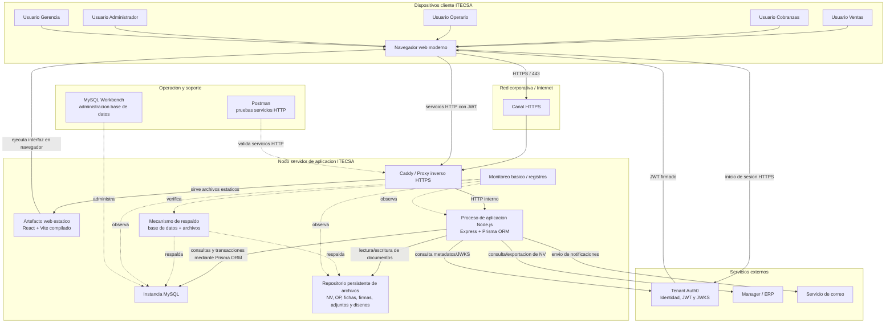

# Vista de Despliegue Fisico-Operacional

Este documento define la arquitectura fisica de despliegue para el sistema de gestion de produccion de Inversiones Tecnologicas S.A. (ITECSA). La vista muestra los nodos, artefactos, servicios externos, persistencia y herramientas operativas que soportan la solucion.

La vista se limita al despliegue fisico y operacional: dispositivos cliente, navegador, red, servidor o maquina virtual, artefactos desplegados, procesos en ejecucion, servicios externos, persistencia, respaldo, monitoreo y herramientas de soporte.

## Sistema de Interes

El sistema de interes es el sistema de gestion de produccion de ITECSA, utilizado por usuarios internos para centralizar pedidos, documentos, trazabilidad, auditoria, notificaciones, reportes y configuracion operativa.

## Interesados y Preocupaciones

| Interesado | Preocupaciones abordadas por esta vista |
| --- | --- |
| Administrador | Disponibilidad del sistema, administracion de usuarios y roles, mantencion operativa, respaldo de datos y documentos. |
| Ventas, Cobranzas, Operario y Gerencia | Acceso seguro desde navegador, continuidad de uso, tiempos de respuesta razonables y disponibilidad de informacion compartida. |
| Equipo de desarrollo | Separacion clara entre artefactos desplegados, dependencias de ejecucion, servicios externos y persistencia para facilitar pruebas y despliegues reproducibles. |
| Administracion tecnica / soporte | Capacidad de operar MySQL, revisar respaldos, monitorear almacenamiento, revisar registros, validar servicios HTTP y mantener certificados o configuracion de acceso remoto. |

## Punto de Vista de Despliegue

| Elemento | Definicion |
| --- | --- |
| Nombre del punto de vista | Punto de vista de despliegue fisico-operacional. |
| Proposito | Describir donde se ejecutan los artefactos del sistema, que nodos participan, como se comunican y que responsabilidades operativas soporta cada elemento. |
| Tipos de modelo usados | Tabla de elementos de despliegue, tabla de protocolos, matriz logico-fisica, tabla de herramientas operativas, reglas de correspondencia y diagrama Mermaid. |
| Convenciones | Los nodos representan ambientes fisicos, virtuales o servicios externos; los artefactos representan software desplegado o dependencias de ejecucion; las flechas representan comunicaciones o relaciones operativas relevantes. |
| Alcance excluido | No describe reglas de negocio internas detalladas ni modelo entidad-relacion. |
| Criterio de completitud | Todo componente logico relevante debe tener nodo/artefacto de despliegue asociado, y todo dato persistente debe estar cubierto por respaldo. |

## Vista de Despliegue

| N | Componente de despliegue | Responsabilidades principales | Tecnologia/Plataforma |
| --- | --- | --- | --- |
| 1 | Dispositivos cliente de usuarios internos | Ejecutar el navegador usado por Ventas, Cobranzas, Operario, Administrador y Gerencia para acceder al sistema. | Windows, macOS, Android o iOS, segun RNF10 |
| 2 | Navegador web del usuario | Cargar el artefacto web estatico, iniciar autenticacion con Auth0 y consumir los servicios HTTP publicados por el sistema. | Google Chrome, Mozilla Firefox, Brave, Opera o Safari, segun RNF09 |
| 3 | Red corporativa / Internet | Transportar trafico HTTPS entre usuarios, servidor de aplicacion y servicios externos. | LAN corporativa, internet, HTTPS |
| 4 | Nodo servidor de aplicacion ITECSA | Alojar el primer despliegue centralizado del sistema: Caddy como proxy inverso, artefacto web estatico, proceso Node.js, MySQL, repositorio de archivos, registros locales y tareas programadas de respaldo. | Maquina virtual o servidor institucional con Intel Core i5 o AMD Ryzen 5 equivalente, 16 GB de RAM y 500 GB disponibles como referencia minima del Documento 0 |
| 5 | Caddy / Proxy inverso HTTPS | Terminar HTTPS, gestionar certificados TLS, servir el artefacto web estatico y enrutar solicitudes de servicios HTTP hacia el proceso Node.js mediante HTTP interno. | Caddy ejecutado como proceso o contenedor |
| 6 | Artefacto web estatico | Entregar la interfaz compilada que se ejecuta en el navegador del usuario. | Artefacto compilado de React + Vite, Bootstrap 5 y CSS |
| 7 | Proceso de aplicacion Node.js | Exponer rutas HTTP, validar solicitudes, validar JWTs, coordinar reglas de negocio, persistencia, documentos, auditoria, integraciones y notificaciones. | Node.js, Express, JavaScript/TypeScript, Prisma ORM como dependencia de acceso a datos |
| 8 | Tenant de identidad externo | Autenticar usuarios, emitir credenciales de acceso e identificacion y publicar metadatos/JWKS para validacion de JWT. | Auth0, JWT |
| 9 | Instancia de base de datos relacional | Persistir usuarios internos, roles, permisos, pedidos, notas de venta, ordenes de produccion, estados Kanban, bitacoras, trazabilidad, auditoria, capacidad, etiquetas, notificaciones, reportes y configuracion. | MySQL alojado inicialmente en el nodo servidor de aplicacion |
| 10 | Repositorio persistente de archivos | Guardar documentos y archivos asociados al flujo productivo: Notas de Venta, Ordenes de Produccion, fichas cliente, firmas electronicas, adjuntos y archivos de diseno. | Volumen persistente del servidor o almacenamiento de objetos definido por operacion |
| 11 | Sistema ERP externo | Proveer informacion asociada a Notas de Venta y recibir/exportar informacion compatible con el flujo comercial existente. | Manager / ERP externo |
| 12 | Servicio externo de correo | Enviar notificaciones automaticas del sistema y comunicaciones asociadas a eventos relevantes. | SMTP corporativo o proveedor de correo transaccional |
| 13 | Mecanismo de respaldo | Respaldar periodicamente la base de datos y el repositorio de archivos para proteger trazabilidad, auditoria, documentos historicos y continuidad operativa. | Tareas programadas, copias de seguridad o herramienta de respaldo administrada |
| 14 | Herramientas de administracion tecnica | Administrar base de datos, revisar respaldos, validar servicios HTTP, monitorear registros/espacio disponible y apoyar mantenciones del despliegue. | MySQL Workbench, Postman, consola del servidor, monitoreo basico/registros |
| 15 | Monitoreo basico y registros | Centralizar o revisar eventos operativos, errores de aplicacion, espacio disponible y salud basica del servidor, Node.js, MySQL, archivos y respaldos. | Registros de aplicacion/servidor, visor de eventos, procedimientos automatizados o herramienta ligera de monitoreo |

## Herramientas Operativas y de Soporte

| Herramienta | Ubicacion operacional | Uso | Relacion con componentes |
| --- | --- | --- | --- |
| Postman | Estacion de desarrollo/soporte o equipo autorizado | Validar puntos de acceso HTTP, contratos, autenticacion con JWT y respuestas de integracion. | Prueba la interfaz de servicios HTTP publicada por Caddy hacia Node.js; no es proceso productivo del sistema. |
| MySQL Workbench | Estacion de administracion tecnica | Modelar, inspeccionar y administrar MySQL cuando la operacion lo requiera. | Se conecta a la instancia MySQL con permisos restringidos. |
| Monitoreo basico / registros | Servidor o maquina virtual y consola de soporte | Revisar errores, eventos, espacio disponible, estado de tareas programadas y salud operativa. | Observa Node.js, MySQL, repositorio de archivos y respaldos. |
| Mecanismo de respaldo | Servidor, maquina virtual o servicio administrado | Respaldar MySQL y archivos, y permitir restauracion verificable. | Cubre Repositorio Relacional y Repositorio Documental. |

## Protocolos y Puertos Relevantes

| Relacion | Protocolo / puerto | Observacion |
| --- | --- | --- |
| Navegador -> Caddy | HTTPS / 443 | Canal externo principal para interfaz y servicios HTTP; Caddy termina HTTPS y gestiona certificados TLS. |
| Caddy -> Proceso Node.js | HTTP interno / puerto configurado | Comunicacion interna dentro del entorno controlado del servidor; no se expone directamente a usuarios finales. |
| Proceso Node.js -> MySQL | MySQL / 3306 o puerto configurado | Acceso mediante Prisma ORM. |
| Navegador -> Auth0 | HTTPS / 443 | Inicio de sesion y recepcion de JWT. |
| Proceso Node.js -> Auth0 | HTTPS / 443 | Consulta de metadatos/JWKS para validar JWT. |
| Proceso Node.js -> Manager/ERP | HTTPS/interfaz de integracion/exportacion segun disponibilidad | Integracion para obtener o exportar datos de Nota de Venta. |
| Proceso Node.js -> Servicio de correo | SMTP, SMTPS o interfaz transaccional | Envio de notificaciones. |
| Proceso Node.js -> Repositorio de archivos | Lectura/escritura local o interfaz de almacenamiento | Lectura/escritura de NV, OP, fichas, firmas y adjuntos. |
| Mecanismo de respaldo -> MySQL/Archivos | Tarea programada o copia de seguridad | Debe cubrir base de datos y repositorio documental. |
| Postman -> Caddy/servicios HTTP | HTTPS / 443 | Validacion controlada de puntos de acceso HTTP. |
| MySQL Workbench -> MySQL | MySQL / 3306 o tunel seguro | Uso administrativo restringido. |
| Monitoreo/registros -> Node.js/MySQL/Archivos/Respaldos | Lectura de registros, metricas o procedimientos automatizados | No modifica datos funcionales; apoya diagnostico. |

## Diagrama Mermaid

## Correspondencias Arquitectonicas

| Elemento de esta vista | Correspondencia con la arquitectura de componentes |
| --- | --- |
| Navegador y artefacto web estatico | Interfaz Web. |
| Caddy / Proxy inverso HTTPS | Punto de entrada operacional para Interfaz Web e Interfaz de Servicios HTTP. Termina HTTPS, gestiona certificados TLS y enruta HTTP interno hacia Node.js. |
| Proceso de aplicacion Node.js | Interfaz de Servicios HTTP y Controladores; componentes funcionales; autorizacion interna; auditoria; integraciones; notificaciones. |
| Prisma ORM como dependencia del proceso Node.js | Acceso a Datos. |
| Instancia MySQL | Repositorio Relacional. |
| Repositorio persistente de archivos | Repositorio Documental usado por Trazabilidad, OP/ficha cliente, Firma Electronica y adjuntos. |
| Tenant Auth0 | Servicio externo Auth0 y Gestion de Usuarios y Roles. |
| Manager / ERP | Servicio externo Manager usado por Gestion de Pedidos y Nota de Venta. |
| Servicio de correo | Servicio externo usado por Notificaciones. |
| Mecanismo de respaldo | Soporte operacional para Repositorio Relacional y Repositorio Documental. |
| Monitoreo basico/registros | Soporte operacional para disponibilidad, diagnostico y revision de auditoria tecnica. |
| Postman | Herramienta de prueba para servicios HTTP y validacion de integraciones. |
| MySQL Workbench | Herramienta de administracion/modelado para MySQL. |

## Tabla de Correspondencias Logico-Fisicas

| Componente logico | Nodo/Artefacto de despliegue | Justificacion |
| --- | --- | --- |
| Interfaz Web | Navegador web moderno; Artefacto web estatico React + Vite; Caddy / Proxy inverso HTTPS | La interfaz se sirve como archivos estaticos por Caddy y se ejecuta en Chrome, Firefox, Brave, Opera o Safari sobre Windows, macOS, Android o iOS. |
| Interfaz de Servicios HTTP y Controladores | Proceso de aplicacion Node.js; Caddy / Proxy inverso HTTPS | Caddy recibe solicitudes HTTPS y las enruta por HTTP interno al proceso de aplicacion Express. |
| Gestion de Usuarios y Roles | Proceso Node.js; Tenant Auth0; Instancia MySQL | Auth0 autentica y emite JWT; Node.js valida JWKS y autoriza roles internos persistidos en MySQL. |
| Gestion de Pedidos y Nota de Venta | Proceso Node.js; Manager/ERP; MySQL; Repositorio persistente de archivos | Node.js ejecuta la logica de pedidos, consume Manager, persiste datos relacionales y adjunta NV/archivos de diseno. |
| Confirmacion de Cobro | Proceso Node.js; MySQL; Repositorio persistente de archivos | Ejecuta cambios de estado de pago, bloqueo/desbloqueo, firma electronica de NV y registro historico. |
| Asociacion de Orden de Produccion y Ficha Cliente | Proceso Node.js; MySQL; Repositorio persistente de archivos | Asocia OP/ficha a pedidos y guarda documentos fuera de la base relacional. |
| Kanban y Seguimiento Productivo | Proceso Node.js; Artefacto web estatico; MySQL | La interfaz web muestra el tablero; Node.js valida transiciones y MySQL persiste estados, subprocesos y Control de calidad. |
| Trazabilidad, Comentarios y Adjuntos | Proceso Node.js; MySQL; Repositorio persistente de archivos | Los eventos estructurados van a MySQL y los adjuntos/documentos al repositorio documental. |
| Capacidad, Plazos y Alertas | Proceso Node.js; MySQL; Artefacto web estatico | Node.js calcula capacidad/plazos y la interfaz web presenta alertas; parametros y resultados se persisten en MySQL. |
| Firma Electronica y Documentos Firmados | Proceso Node.js; Repositorio persistente de archivos; MySQL | Node.js incorpora la firma electronica registrada del usuario en documentos y guarda metadatos en MySQL. |
| Gestion de Prioridad y Etiquetas Visuales | Proceso Node.js; MySQL; Artefacto web estatico | Node.js controla asignacion de prioridad/etiquetas; la interfaz web las presenta en Kanban y reportes. |
| Notificaciones | Proceso Node.js; Servicio externo de correo; MySQL | Node.js genera eventos, consulta destinatarios y usa correo externo; MySQL conserva estado de notificacion. |
| Reportes e Indicadores | Proceso Node.js; MySQL; Artefacto web estatico | Node.js consulta datos historicos y entrega indicadores/exportaciones a la interfaz. |
| Administracion del Sistema | Proceso Node.js; MySQL; Artefacto web estatico | La configuracion se gestiona por la interfaz web y se persiste como parametros del sistema. |
| Auditoria y Bitacora de Seguridad | Proceso Node.js; MySQL; Monitoreo basico/registros; Mecanismo de respaldo | Node.js registra eventos auditables con hora de servidor; MySQL conserva la bitacora y los respaldos protegen su recuperacion. |
| Acceso a Datos | Prisma ORM dentro de Node.js | Prisma implementa el acceso transaccional a MySQL. |
| Repositorio Relacional | Instancia MySQL | Persistencia estructurada de datos de negocio, auditoria y configuracion. |
| Repositorio Documental | Repositorio persistente de archivos | Persistencia de NV, OP, fichas cliente, firmas electronicas, adjuntos y archivos de diseno. |
| Servicios externos Auth0, Manager y Correo | Tenant Auth0; Manager/ERP; Servicio de correo | Son dependencias externas consumidas por el sistema propio. |
| Herramientas operativas | Postman; MySQL Workbench; Monitoreo/registros; Respaldos | Apoyan pruebas, administracion, diagnostico y continuidad; no implementan reglas funcionales. |

## Reglas de Correspondencia y Consistencia

| Regla | Criterio de consistencia |
| --- | --- |
| Acceso web | Toda solicitud de usuario hacia el sistema debe ingresar por HTTPS a traves de Caddy. |
| Ejecucion de reglas de negocio | Las reglas de negocio y validaciones protegidas se ejecutan en el proceso Node.js, no en el navegador ni directamente en la base de datos. |
| Seguridad | Toda solicitud protegida hacia los servicios HTTP debe transportar un JWT emitido por Auth0 y validado por el proceso Node.js antes de aplicar autorizacion interna. |
| Roles | Los actores de sistema deben usar los roles RF04: Administrador, Gerencia, Operario, Ventas y Cobranzas. |
| Compatibilidad cliente | La vista de despliegue debe admitir navegadores RNF09 y sistemas operativos RNF10. |
| Persistencia relacional | Las operaciones sobre datos relacionales deben pasar por el proceso Node.js usando Prisma ORM hacia MySQL. |
| Persistencia documental | Los documentos y adjuntos se almacenan en el repositorio persistente de archivos y deben quedar cubiertos por el mecanismo de respaldo. |
| Auditoria | La fecha/hora de servidor y eventos asociados a usuarios desactivados deben conservarse en MySQL y quedar cubiertos por respaldo. |
| Respaldo minimo | El respaldo debe cubrir MySQL y archivos; se recomienda respaldo diario y prueba periodica de restauracion. |
| Herramientas operativas | Postman, MySQL Workbench y monitoreo/registros se ubican en Operacion y soporte, no como artefactos funcionales del sistema. |
| Servicios externos | Auth0, Manager y correo se consideran sistemas fuera del limite operacional directo de ITECSA; el sistema propio consume sus interfaces disponibles. |

## Supuestos de Despliegue

- La topologia inicial usa un servidor o maquina virtual institucional centralizado, de acuerdo con la infraestructura minima disponible para el proyecto.
- Caddy debe terminar HTTPS, gestionar certificados TLS, servir el artefacto web estatico y enrutar solicitudes de servicios HTTP al proceso Node.js mediante HTTP interno.
- MySQL y el repositorio de archivos se alojan inicialmente en el nodo servidor de aplicacion para simplificar la primera operacion; podran separarse si la carga o crecimiento lo requiere.
- El servicio de correo puede operar mediante SMTP corporativo o proveedor transaccional, siempre que soporte las notificaciones del sistema.
- El mecanismo de respaldo debe cubrir base de datos y archivos, independiente de la herramienta especifica disponible.
- El monitoreo basico puede operar inicialmente con registros de servidor/aplicacion y revision de espacio/tareas programadas, sin exigir una plataforma dedicada.

## Decisiones y Justificacion

- Esta vista documenta nodos, procesos y artefactos de ejecucion para mostrar donde se despliega cada parte ejecutable.
- Auth0 opera como tenant externo de identidad porque autentica usuarios y emite credenciales/JWT firmados.
- El proceso Node.js valida los JWT emitidos por Auth0 mediante metadatos/JWKS y mantiene la autorizacion interna por roles y permisos, en correspondencia con Gestion de Usuarios y Roles.
- Prisma ORM funciona como dependencia del proceso Node.js, no como nodo fisico independiente, porque intermedia consultas, migraciones y manipulacion de datos hacia MySQL.
- El despliegue inicial centralizado reduce complejidad operativa y mantiene correspondencia clara entre aplicacion, persistencia y archivos durante el primer incremento.
- Los archivos adjuntos se almacenan fuera de MySQL para evitar sobrecargar la base relacional con binarios y facilitar respaldo, crecimiento y restauracion.
- HTTPS es el canal externo para proteger el acceso de usuarios internos hasta Caddy. Desde Caddy hacia Node.js se usa HTTP interno dentro del entorno controlado del servidor.
- La compatibilidad cliente sigue RNF09 y RNF10: navegadores Chrome, Firefox, Brave, Opera y Safari sobre Windows, macOS, Android e iOS.
- Los respaldos programados protegen informacion operativa, trazabilidad historica, auditoria y documentos productivos necesarios para la continuidad del servicio.
- Postman, MySQL Workbench y monitoreo/registros son soporte operacional para validacion, administracion, diagnostico y continuidad. No implementan reglas funcionales del sistema.

## Justificacion de Herramientas Operativas

Postman permite validar puntos de acceso HTTP, contratos, autenticacion y respuestas de integracion. MySQL Workbench permite modelar, inspeccionar y administrar la base de datos. Monitoreo basico/registros y respaldos sostienen continuidad operacional, trazabilidad y conservacion historica: el sistema centraliza pedidos, documentos, auditoria y eventos de produccion, por lo que debe poder diagnosticarse y recuperarse ante fallas.
