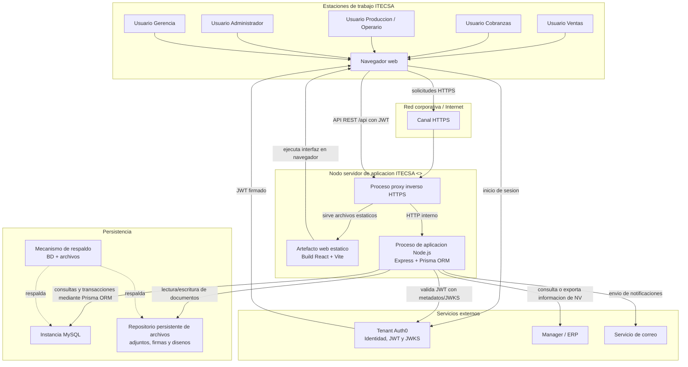

# Diagrama de Despliegue

Este documento define una primera version de la arquitectura fisica de despliegue para el sistema de gestion de produccion de ITECSA. La descripcion se basa en el Documento 0 y se organiza como una descripcion arquitectonica alineada con ISO/IEC/IEEE 42010: identifica el sistema de interes, los interesados, sus preocupaciones, el punto de vista usado, la vista de despliegue, las correspondencias y la justificacion de las decisiones tecnicas.

## Sistema de Interes

El sistema de interes es el sistema de gestion de produccion de ITECSA, utilizado por usuarios internos para centralizar pedidos, documentos, trazabilidad, notificaciones, reportes y configuracion operativa. Esta vista se limita al despliegue fisico y operacional: nodos de ejecucion, artefactos desplegados, servicios externos, persistencia, red y mecanismos de respaldo.

## Interesados y Preocupaciones

| Interesado | Preocupaciones abordadas por esta vista |
| --- | --- |
| Administrador del sistema | Disponibilidad del sistema, administracion de usuarios y roles, mantencion operativa, respaldo de datos y documentos. |
| Ventas, Cobranzas, Produccion y Gerencia | Acceso seguro desde navegador, continuidad de uso, tiempos de respuesta razonables y disponibilidad de informacion compartida. |
| Equipo de desarrollo | Separacion clara entre artefactos desplegados, dependencias runtime, servicios externos y persistencia para facilitar pruebas y despliegues reproducibles. |
| Administracion tecnica / soporte | Capacidad de operar MySQL, revisar respaldos, monitorear almacenamiento y mantener certificados o configuracion de acceso remoto. |

## Punto de Vista de Despliegue

| Elemento | Definicion |
| --- | --- |
| Nombre del punto de vista | Punto de vista de despliegue fisico-operacional. |
| Proposito | Describir donde se ejecutan los artefactos del sistema, que nodos participan, como se comunican y que responsabilidades operativas soporta cada elemento. |
| Tipos de modelo usados | Tabla de elementos de despliegue y diagrama Mermaid de nodos, artefactos, servicios externos y relaciones de comunicacion. |
| Convenciones | Los nodos representan ambientes fisicos, virtuales o servicios externos; los artefactos representan software desplegado o dependencias runtime; las flechas representan comunicaciones o relaciones operativas relevantes. |
| Alcance excluido | No describe reglas de negocio internas, flujos funcionales detallados ni modelo entidad-relacion. |

## Vista de Despliegue

| N | Componente de despliegue | Responsabilidades principales | Tecnología/Plataforma |
| --- | --- | --- | --- |
| 1 | Estaciones de trabajo de usuarios internos | Ejecutar el navegador usado por Ventas, Cobranzas, Produccion, Administracion y Gerencia para acceder al sistema. | Equipos cliente con Windows 10 o superior o macOS 26 o superior, segun Documento 0 |
| 2 | Navegador web del usuario | Cargar el artefacto web estatico, iniciar autenticacion con Auth0 y consumir los servicios HTTP publicados por el sistema. | Navegador web moderno |
| 3 | Red corporativa / Internet | Transportar trafico HTTPS entre usuarios, servidor de aplicacion y servicios externos. | LAN corporativa, internet, HTTPS |
| 4 | Nodo servidor de aplicacion ITECSA | Alojar el punto de entrada web y los procesos de aplicacion requeridos para el primer despliegue del sistema. | VM o servidor centralizado con Intel Core i5 o AMD Ryzen 5 equivalente, 16 GB de RAM y 500 GB disponibles <<suposición: el Documento 0 define infraestructura minima, pero no prescribe topologia fisica>> |
| 5 | Proceso proxy inverso HTTPS | Terminar HTTPS, servir el artefacto web estatico y enrutar solicitudes `/api` hacia el proceso Node.js. | Nginx o Caddy ejecutado como proceso o contenedor <<suposición: el Documento 0 define HTTPS en acceso remoto, pero no prescribe proxy especifico ni runtime de despliegue>> |
| 6 | Artefacto web estatico | Entregar la interfaz compilada que se ejecuta en el navegador del usuario. | Build de React + Vite, Bootstrap 5 y CSS |
| 7 | Proceso de aplicacion Node.js | Exponer rutas HTTP, validar solicitudes, aplicar reglas de negocio, validar JWTs, coordinar persistencia, documentos, integraciones y notificaciones. | NodeJS, Express, JavaScript/TypeScript, Prisma ORM como dependencia de acceso a datos; ejecutado como proceso o contenedor <<suposición: el Documento 0 define stack de aplicacion y Prisma, pero no prescribe contenedores>> |
| 8 | Tenant de identidad externo | Autenticar usuarios, emitir credenciales de acceso e identificacion y publicar metadatos/JWKS para validacion de JWT. | Auth0, JWT |
| 9 | Instancia de base de datos relacional | Persistir usuarios internos, roles, permisos, pedidos, notas de venta, ordenes de produccion, estados Kanban, bitacoras, trazabilidad, capacidad, etiquetas, notificaciones, reportes y configuracion. | MySQL |
| 10 | Repositorio persistente de archivos | Guardar documentos y archivos asociados al flujo productivo: Notas de Venta, Ordenes de Produccion, fichas cliente, firmas electronicas y archivos de diseno. | Volumen persistente del servidor o almacenamiento de objetos <<suposición: se separan archivos de MySQL para facilitar crecimiento de almacenamiento>> |
| 11 | Sistema ERP externo | Proveer o recibir informacion asociada a Notas de Venta y archivos compatibles con el flujo comercial existente. | Manager / ERP externo |
| 12 | Servicio externo de correo | Enviar notificaciones automaticas del sistema y comunicaciones asociadas a eventos relevantes. | SMTP corporativo o proveedor de correo transaccional <<suposición: el Documento 0 exige envio de correos, pero no define proveedor ni protocolo especifico>> |
| 13 | Mecanismo de respaldo | Respaldar periodicamente la base de datos y el repositorio de archivos para proteger trazabilidad, documentos historicos y continuidad operativa. | Jobs programados, snapshots o herramienta de respaldo administrada <<suposición: el Documento 0 exige seguridad y respaldo, pero no define herramienta especifica>> |
| 14 | Herramientas de administracion tecnica | Administrar la base de datos, revisar respaldos, monitorear espacio disponible y apoyar mantenciones del despliegue. | MySQL Workbench; consola del servidor y monitoreo basico <<suposición: el Documento 0 define MySQL Workbench, pero no prescribe herramientas operativas de monitoreo>> |

## Diagrama Mermaid

## Correspondencias Arquitectonicas

| Elemento de esta vista | Correspondencia con la arquitectura de componentes |
| --- | --- |
| Artefacto web estatico y navegador | Capa de Vista: React, Vite, Bootstrap 5 y CSS. |
| Proceso de aplicacion Node.js | Capa de Controladores y Logica de Negocio: Express, JavaScript/TypeScript, validaciones, reglas y autorizacion interna. |
| Prisma ORM como dependencia del proceso Node.js | Capa de Datos: intermediario de consultas, migraciones y manipulacion de datos hacia MySQL. |
| Instancia MySQL | Capa de Datos: persistencia relacional principal. |
| Tenant Auth0 | Servicios Externos / Seguridad: autenticacion, emision de JWT y soporte para validacion de identidad. |
| Manager / ERP y Servicio de correo | Servicios Externos: integracion comercial y comunicaciones. |
| Repositorio persistente de archivos | Soporte fisico para documentos, adjuntos y firmas requeridos por componentes de trazabilidad y documentos. |

## Reglas de Correspondencia y Consistencia

| Regla | Criterio de consistencia |
| --- | --- |
| Acceso web | Toda solicitud de usuario hacia el sistema debe ingresar por el canal HTTPS y el proceso proxy inverso. |
| Ejecucion de reglas de negocio | Las reglas de negocio y validaciones protegidas se ejecutan en el proceso de aplicacion Node.js, no en el navegador ni directamente en la base de datos. |
| Seguridad | Toda solicitud protegida hacia la API debe transportar un JWT emitido por Auth0 y validado por el proceso Node.js antes de aplicar autorizacion interna. |
| Persistencia relacional | Las operaciones sobre datos relacionales deben pasar por el proceso Node.js usando Prisma ORM hacia MySQL. |
| Persistencia documental | Los documentos y adjuntos se almacenan en el repositorio persistente de archivos y deben quedar cubiertos por el mecanismo de respaldo. |
| Servicios externos | Auth0, Manager y correo se consideran sistemas fuera del limite operacional directo de ITECSA; el sistema propio solo consume sus interfaces disponibles. |

## Decisiones y Justificacion

- Se documentan nodos, procesos y artefactos de ejecucion en lugar de capas conceptuales, porque el objetivo de esta vista es tecnico-operacional: mostrar donde se despliega cada parte ejecutable.
- Se incorpora Auth0 como tenant externo de identidad porque el Documento 0 lo define como proveedor de autenticacion que emite credenciales y JWT firmados digitalmente.
- El proceso Node.js valida los JWT emitidos por Auth0 mediante metadatos/JWKS y mantiene la autorizacion interna por roles y permisos, en correspondencia con la gestion de usuarios y roles del diagrama de componentes.
- Prisma ORM se documenta como dependencia del proceso Node.js, no como nodo fisico independiente, porque su responsabilidad es intermediar consultas, migraciones y manipulacion de datos hacia MySQL.
- Se propone ejecutar proxy y proceso Node.js como procesos o contenedores <<suposición: el Documento 0 define el stack tecnologico, pero no prescribe mecanismo exacto de despliegue>>. Esta decision facilita reproducir el entorno entre desarrollo y despliegue inicial.
- Los archivos adjuntos se almacenan fuera de MySQL <<suposición: el Documento 0 exige resguardar documentos, firmas, disenos y registros historicos, pero no define mecanismo fisico de almacenamiento>>. Esto evita sobrecargar la base relacional con binarios y permite aumentar capacidad de disco con menor impacto.
- Se utiliza HTTPS como canal de entrada porque el Documento 0 contempla uso de HTTPS en caso de acceso remoto.
- La infraestructura de referencia considera Intel Core i5 o AMD Ryzen 5 equivalente, 16 GB de RAM, 500 GB disponibles, Windows 10 o superior y macOS 26 o superior, segun la dimension tecnica del Documento 0.
- El servicio de correo se representa como SMTP corporativo o proveedor transaccional <<suposición: el Documento 0 exige notificaciones y recuperacion mediante correo, pero no define plataforma de envio>>.
- La administracion tecnica considera MySQL Workbench porque esta definido en el Documento 0; la consola del servidor y el monitoreo basico quedan como apoyo operativo <<suposición: el Documento 0 no prescribe herramientas de operacion>>.
- Se incluyen respaldos programados porque el sistema centraliza informacion operativa, trazabilidad historica y documentos productivos que deben conservarse para continuidad del servicio.
