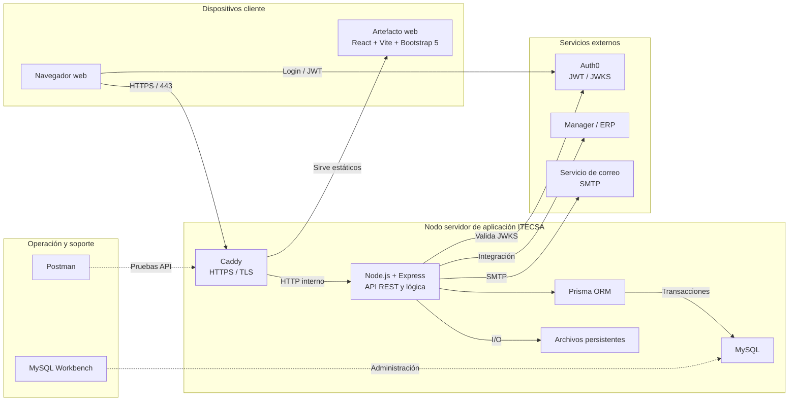

# Diagrama de Despliegue

## Propósito y fuentes

Este documento describe la vista física y operacional del Sistema de Gestión de Producción para ITECSA. Presenta los artefactos ejecutables, persistencias, servicios externos y herramientas de soporte de su despliegue.

Fuentes de referencia:

- [Documento 0](../Documentos/Documento%200/doc%200%20para%20finalizar.docx.md), especialmente el Anexo I de dimensión técnica y los requisitos RNF09-RNF10.
- [Diagrama de Despliegue](./Diagrama%20de%20Despliegue.drawio), fuente gráfica de los nodos y relaciones descritos en esta vista.
- [Vista de Componentes](./Diagrama_de_componentes.md), que detalla las responsabilidades lógicas desplegadas en estos nodos.

## Vista general

El despliegue representado utiliza una aplicación web atendida por un nodo servidor de aplicación. Los usuarios acceden desde un navegador; Caddy recibe las conexiones HTTPS y publica el artefacto web o dirige solicitudes a la aplicación Node.js. La aplicación emplea Prisma ORM para acceder a MySQL y utiliza archivos persistentes para los documentos asociados a los pedidos.

El diagrama incluye como servicios externos Auth0, Manager / ERP y el servicio de correo. Incluye también Postman y MySQL Workbench como herramientas de operación y soporte, no como módulos funcionales.

## Elementos de despliegue

| Elemento | Tecnología o plataforma | Responsabilidad |
| --- | --- | --- |
| Navegador web | Chrome, Firefox, Brave, Opera o Safari | Ejecutar la interfaz web y permitir la interacción de usuarios internos. |
| Artefacto web | React, Vite, Bootstrap 5, CSS | Proporcionar las vistas del sistema en el navegador. |
| Caddy / proxy inverso | Caddy, HTTPS/TLS | Publicar la interfaz mediante HTTPS y enrutar solicitudes HTTP internas hacia la aplicación. |
| Proceso de aplicación | Node.js, Express, JavaScript | Implementar API REST, validaciones y reglas de negocio. |
| Acceso a datos | Prisma ORM | Intermediar consultas y operaciones de persistencia. |
| Base de datos | MySQL | Almacenar información estructurada del sistema. |
| Archivos persistentes | Volumen de almacenamiento mostrado en el diagrama | Mantener Notas de Venta, órdenes de producción, fichas cliente, firmas electrónicas y adjuntos requeridos por el flujo. |
| Autenticación externa | Auth0, JWT, JWKS | Gestionar autenticación y credenciales de acceso. |
| Manager / ERP | Sistema externo | Proporcionar información comercial asociada a datos de venta. |
| Servicio de correo | SMTP | Enviar mensajes requeridos por recuperación de contraseña y notificaciones. |
| Postman | Herramienta de soporte | Probar los servicios API durante desarrollo o validación técnica. |
| MySQL Workbench | Herramienta de soporte | Modelar y administrar MySQL. |

## Actores y acceso

| Actor | Acceso requerido |
| --- | --- |
| Administrador | Administración de usuarios, parámetros, planificación, prioridad y anuncios. |
| Gerencia | Panel de control, reportes e indicadores. |
| Operario | Seguimiento de producción, subprocesos, comentarios y etiquetas autorizadas. |
| Ventas | Registro de pedidos, documentos y avisos asociados. |
| Cobranzas | Actualización del estado de pago. |

El acceso se realiza por navegador web. RNF09 requiere compatibilidad con Google Chrome, Mozilla Firefox, Brave, Opera y Safari en computadores, tabletas y teléfonos móviles. RNF10 requiere compatibilidad con Windows, macOS, Android e iOS.

## Comunicaciones representadas

| Origen | Destino | Comunicación | Propósito |
| --- | --- | --- | --- |
| Navegador web | Caddy | HTTPS / 443 | Acceder a la interfaz y a los servicios HTTP publicados. |
| Caddy | Artefacto web | Servicio de archivos estáticos | Entregar la interfaz React/Vite compilada. |
| Caddy | Proceso Node.js | HTTP interno | Enrutar solicitudes de la API REST. |
| Navegador web | Auth0 | Login / JWT mediante HTTPS | Autenticar al usuario y obtener credenciales. |
| Proceso Node.js | Auth0 | Validación JWKS mediante HTTPS | Validar credenciales JWT según lo representado en el diagrama. |
| Proceso Node.js | Prisma ORM / MySQL | Consultas y transacciones | Consultar y persistir datos estructurados. |
| Proceso Node.js | Archivos persistentes | Entrada/salida de documentos | Gestionar documentos y adjuntos del pedido. |
| Proceso Node.js | Manager / ERP | Integración | Consultar datos comerciales asociados a la Nota de Venta. |
| Proceso Node.js | Servicio de correo | SMTP | Enviar correos requeridos por el sistema. |
| Postman | Caddy / API REST | Pruebas API | Validar servicios HTTP. |
| MySQL Workbench | MySQL | Administración | Modelar o administrar la persistencia relacional. |

## Diagrama lógico del despliegue

## Correspondencia lógica y física

| Responsabilidad lógica | Elemento desplegado |
| --- | --- |
| Presentación de formularios, Kanban, planificación, anuncios y reportes | Artefacto web ejecutado en el navegador. |
| Servicios HTTP y reglas del sistema | Proceso Node.js con Express, publicado mediante Caddy. |
| Acceso a datos estructurados | Prisma ORM y MySQL. |
| Conservación de documentos asociados al pedido | Archivos persistentes representados en el nodo servidor. |
| Autenticación y JWT | Servicio externo Auth0. |
| Recuperación de contraseña y notificación de entrega | Servicio externo de correo. |
| Relación con información comercial | Manager / ERP. |
| Prueba y administración técnica | Postman y MySQL Workbench. |

## Restricciones y decisiones respaldadas

| Aspecto | Definición vigente |
| --- | --- |
| Seguridad de publicación | Caddy publica la interfaz con HTTPS y enruta mediante HTTP interno, conforme a la dimensión técnica y el diagrama. |
| Identidad | Auth0 emite credenciales JWT; el diagrama muestra validación mediante JWKS. |
| Persistencia relacional | MySQL es la base de datos declarada y Prisma ORM intermedia el acceso. |
| Persistencia documental | El diagrama muestra almacenamiento de archivos para documentos y adjuntos del proceso. |
| Infraestructura mínima recomendada | Procesador Intel Core i5 o AMD Ryzen 5 equivalente, 16 GB de RAM y 500 GB disponibles, según el Anexo I. |
| Compatibilidad | Navegadores y sistemas operativos indicados por RNF09-RNF10. |
