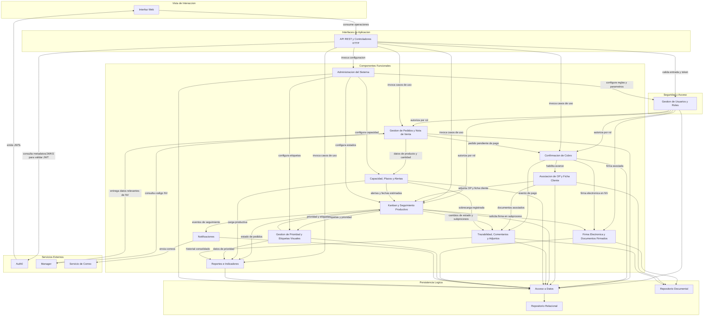
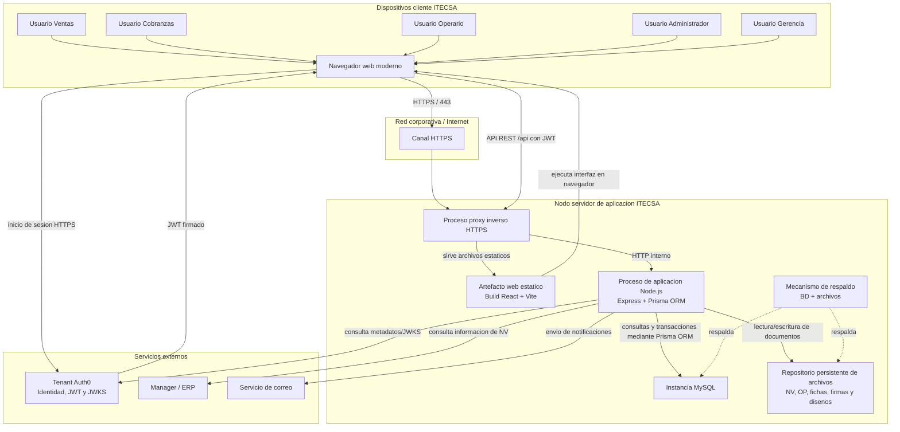

# Informe de Cumplimiento Normativo - Documentos de Arquitectura ITECSA

## Resumen ejecutivo

Este informe revisa los documentos `Diagrama_de_componentes.md` y `Diagrama_de_despliegue.md` sin modificar los archivos originales. La revision considera:

- ISO/IEC/IEEE 42010, en cuanto a sistema de interes, interesados, preocupaciones, puntos de vista, vistas, modelos, correspondencias, reglas de consistencia y justificacion.
- ESA BSSC(96)2 / PSS-05 lite, especialmente fase RS/DA, requisitos RS04-RS18, DA02-DA24 y plantilla DES del Apendice C.
- Documento 0 del proyecto ITECSA, como fuente de consistencia para nombre institucional, roles, tecnologias, navegadores, sistemas operativos, Auth0/JWT, MySQL y Prisma.
- Feedback externo recibido, aceptado solo cuando queda respaldado por la normativa o por el Documento 0.

Hallazgos criticos: 3
Hallazgos mayores: 11
Hallazgos menores: 4

## Referencias normativas usadas

| Fuente | Uso en esta revision |
| --- | --- |
| ISO/IEC/IEEE 42010:2022, [pagina ISO](https://www.iso.org/standard/74393.html) | Requisitos generales para descripciones de arquitectura, puntos de vista, vistas y correspondencias. |
| ISO/IEC/IEEE 42010, [modelo conceptual](https://www.iso-architecture.org/ieee-1471/cm/) | Relacion entre stakeholders, concerns, viewpoints, views, correspondences y rationale. |
| ESA BSSC(96)2 / PSS-05 lite, PDF `BSSC962-ES.PDF` | Guia aplicable a proyectos pequenos; permite combinar RS y DA en DES, pero mantiene exigencias de trazabilidad, consistencia, interfaces, componentes, recursos y revision. |
| Documento 0, `docs/Documentos/Documento 0/Grupo 10 - Documento 0.docx.md` | Fuente de consistencia del proyecto: empresa Inversiones Tecnologicas S.A., roles RF04, navegadores RNF09, sistemas operativos RNF10 e infraestructura minima. |

## Detalle de hallazgos

| ID | Documento afectado | Seccion / Linea | Requisito normativo | Descripcion del problema | Propuesta de correccion textual | Prioridad |
| --- | --- | --- | --- | --- | --- | --- |
| H-001 | Ambos documentos | Encabezado y estructura general | ESA BSSC(96)2, Apendice C: todos los documentos deberian contener resumen, indice, hoja de estado e informacion de cambios; ISO 42010 exige identificar adecuadamente la descripcion de arquitectura. | Los documentos inician directamente con la vista y no contienen metadatos documentales, referencias, estado ni control de cambios. | Agregar secciones `Resumen`, `Informacion del documento`, `Referencias`, `Indice` o equivalente simplificado al inicio de cada documento. | Mayor |
| H-002 | Ambos documentos | Sistema de Interes, lineas 3/9 y 3/7 | ISO 42010: la descripcion debe identificar el sistema de interes; Documento 0 identifica la empresa como Inversiones Tecnologicas S.A. | Los documentos usan ITECSA sin declarar su relacion con el nombre institucional del Documento 0. | Reemplazar por: `Sistema de gestion de produccion para Inversiones Tecnologicas S.A. (ITECSA)` y declarar que ITECSA sera la sigla usada. | Mayor |
| H-003 | Ambos documentos | Interesados y roles, componentes lineas 18/40/42/44/45; despliegue lineas 14/32/54 | ISO 42010: stakeholders y concerns deben identificarse con claridad; Documento 0 RF04 define roles obligatorios. | Se usa `Produccion` como rol o mezclado con `Operario`, aunque RF04 define formalmente el rol `Operario`. | Usar `Operario` para roles del sistema y reservar `area de produccion` para contexto organizacional. | Mayor |
| H-004 | Diagrama de Componentes | Vista de Componentes, Datos, Flujo, lineas 38/57/89 | ESA BSSC(96)2 DA06-DA13: por componente deben definirse entradas, funciones, salidas y datos de interfaz; Documento 0 distingue firma digital de JWT y firma electronica de usuario. | El documento usa `firma digital` para acciones de aprobacion documental sin precisar certificados ni no repudio criptografico. | Reemplazar por `firma electronica registrada del usuario`, dejando `firmado digitalmente` solo para JWT de Auth0. | Mayor |
| H-005 | Diagrama de Componentes | Vista de Componentes, lineas 34-47 | ESA BSSC(96)2 DA06-DA09 y DA17-DA18: el DDA/DES debe definir componentes, interfaces, entradas, salidas y dependencias. | La tabla principal describe responsabilidades y roles, pero no declara explicitamente entradas, salidas ni dependencias por componente. | Ampliar la tabla de componentes con columnas `Entradas principales`, `Salidas principales` y `Dependencias / interfaces`. | Critico |
| H-006 | Diagrama de Componentes | Diagrama Mermaid y relaciones, lineas 236-338 | ISO 42010: una vista debe estar gobernada por su punto de vista y todos sus elementos relevantes deben estar definidos; ESA BSSC(96)2 DA17-DA18 exige componentes e interfaces. | El Mermaid incluye Interfaz Web, API REST, Acceso a Datos, Repositorio Relacional y servicios externos, pero la tabla principal solo cubre componentes funcionales. | Agregar una tabla `Elementos logicos de soporte e interfaces` que describa esos elementos, tipo y responsabilidad. | Mayor |
| H-007 | Diagrama de Componentes | Reglas de Correspondencia, lineas 225-233 | ESA BSSC(96)2 RS13, DA21 y DD16: deben existir matrices de trazabilidad entre requisitos, software y componentes. | Hay reglas generales, pero no hay matriz que trace requisitos Documento 0 contra componentes. | Agregar `Matriz de trazabilidad requisitos-componentes` con RF/RNF relevantes y componente responsable. | Critico |
| H-008 | Diagrama de Componentes | Punto de Vista y Justificacion, lineas 22-30 y 340-346 | ISO 42010: el punto de vista debe enmarcar preocupaciones y convenciones; la arquitectura debe registrar rationale. | El punto de vista declara proposito y modelos, pero no vincula explicitamente preocupaciones con modelos ni criterios de completitud. | Agregar `Correspondencia interesados-preocupaciones-modelos` y criterios de completitud del punto de vista. | Menor |
| H-009 | Diagrama de Componentes | Mermaid, lineas 247-248 | Auth0/JWT en Documento 0; ISO 42010 exige consistencia semantica entre relaciones. | La relacion `API valida identidad con proveedor` puede sugerir que el backend autentica al usuario directamente en Auth0, cuando el backend valida JWT con JWKS/metadatos. | Cambiar etiqueta a `consulta metadatos/JWKS para validar JWT`. | Menor |
| H-010 | Diagrama de Componentes | Componente `Gestion de Prioridad y Sobrecarga Operativa`, lineas 44/63 | ESA BSSC(96)2 DA04 y DA22: la descomposicion debe ser top-down y consistente, evitando solapamiento ambiguo. | La sobrecarga queda repartida entre Capacidad y Prioridad, generando solapamiento de responsabilidades. | Renombrar a `Gestion de Prioridad y Etiquetas Visuales`; dejar el calculo de sobrecarga en `Capacidad, Plazos y Alertas`. | Mayor |
| H-011 | Diagrama de Despliegue | Vista de Despliegue, linea 32; Justificacion linea 140 | Documento 0 RNF09-RNF10: navegadores Chrome, Firefox, Brave, Opera y Safari; compatibilidad Windows, macOS, Android e iOS. | El documento indica `Windows 10 o superior o macOS 26 o superior`, omitiendo Android/iOS y los navegadores definidos por RNF09. | Sustituir por dispositivos Windows, macOS, Android e iOS con navegador moderno Chrome, Firefox, Brave, Opera o Safari. | Mayor |
| H-012 | Diagrama de Despliegue | Vista y Mermaid, lineas 35/64/70 | ISO 42010 correspondencias y ESA BSSC(96)2 DA15: recursos operacionales deben evaluarse y definirse. | No queda claro si MySQL y archivos estan en el mismo servidor, servidor separado o servicio externo. | Declarar topologia inicial: servidor/VM institucional centralizada aloja proxy, Node.js, MySQL y repositorio de archivos; Auth0, Manager y correo son externos. | Critico |
| H-013 | Diagrama de Despliegue | Vista, Mermaid y Justificacion, lineas 35-45/64/137-142 | ISO 42010: los modelos deben ser legibles y seguir convenciones; ESA BSSC(96)2 requiere documentos claros y consistentes. | Las notas `<<suposicion: ...>>` aparecen dentro de tablas y del Mermaid, mezclando modelo con rationale. | Moverlas a una seccion `Supuestos de despliegue` y limpiar el diagrama. | Mayor |
| H-014 | Diagrama de Despliegue | Diagrama Mermaid y reglas, lineas 47-106/120-129 | ESA BSSC(96)2 DA14 y DA17-DA18: deben definirse flujo de control e interfaces; ISO 42010 exige reglas de correspondencia verificables. | Las comunicaciones no indican protocolos o puertos principales. | Agregar tabla `Protocolos y puertos relevantes` con HTTPS/443, HTTP interno, MySQL/3306, HTTPS a Auth0/Manager y SMTP/API correo. | Mayor |
| H-015 | Diagrama de Despliegue | Correspondencias Arquitectonicas, lineas 108-118 | ISO 42010: correspondencias permiten trazabilidad, consistencia y refinamiento entre vistas. | La correspondencia con componentes esta agregada por capas, pero no traza todos los componentes logicos funcionales al proceso Node.js. | Agregar matriz de correspondencia logico-fisica por grupo funcional, soporte y servicios externos. | Mayor |
| H-016 | Diagrama de Despliegue | Mecanismo de respaldo, lineas 44/103-104/128 | ESA BSSC(96)2 DA15 y Documento 0 continuidad/seguridad: deben definirse recursos operacionales necesarios. | El respaldo se menciona, pero no se explicita alcance minimo, frecuencia ni restauracion verificable. | Especificar respaldo diario minimo de MySQL y archivos, retencion definida por el proyecto y prueba periodica de restauracion. | Mayor |
| H-017 | Ambos documentos | Diagramas Mermaid | ISO 42010: modelos deben estar construidos con convenciones definidas por el viewpoint. | No hay leyenda de tipos de elementos o flechas, lo que reduce verificabilidad de convenciones. | Agregar convenciones/leyenda breve para nodos internos, servicios externos, artefactos, persistencia y relaciones punteadas. | Menor |
| H-018 | Ambos documentos | Texto completo | ESA BSSC(96)2 DA22 y RS14: los documentos deben ser consistentes. | Hay variacion terminologica y ortografica: `NodeJS`/`Node.js`, `produccion` como area y rol, `Servicio de Correo`/`correo`. | Normalizar terminos en todo el texto corregido. | Menor |

## Verificacion transversal de consistencia

| Elemento en vista logica | Correspondencia esperada en despliegue | Estado actual | Correccion incorporada |
| --- | --- | --- | --- |
| Interfaz Web | Navegador + artefacto web estatico React/Vite | Existe, pero sin navegadores RNF09 | Se corrige compatibilidad cliente y navegadores. |
| API REST y Controladores HTTP | Proxy HTTPS + proceso Node.js/Express | Existe | Se agrega protocolo y correspondencia explicita. |
| Componentes funcionales | Proceso de aplicacion Node.js | Existe solo agregado por capa | Se agrega matriz logico-fisica. |
| Gestion de Usuarios y Roles | Node.js + Auth0/JWT/JWKS | Existe | Se precisa validacion JWKS y autorizacion interna. |
| Acceso a Datos | Prisma ORM como dependencia Node.js | Existe | Se mantiene y se traza. |
| Repositorio Relacional | Instancia MySQL | Existe | Se aclara ubicacion en topologia inicial. |
| Documentos/adjuntos/firma electronica | Repositorio persistente de archivos | Existe | Se refuerza respaldo y alcance documental. |
| Auth0 | Tenant externo Auth0 | Existe | Se precisa autenticacion y validacion JWT. |
| Manager | Manager / ERP externo | Existe | Se mantiene como servicio externo. |
| Servicio de Correo | SMTP corporativo o proveedor transaccional | Existe | Se agrega protocolo/API. |

## Documentos corregidos

### 1. Diagrama de Componentes (corregido)

````markdown
# Diagrama de Componentes

<!-- CAMBIO: Se agregan metadatos documentales simplificados exigidos por ESA BSSC(96)2, Apendice C. -->

## Resumen

Este documento define la vista logica de componentes del sistema de gestion de produccion para Inversiones Tecnologicas S.A. (ITECSA). La descripcion esta alineada con ISO/IEC/IEEE 42010 y con los criterios aplicables de ESA BSSC(96)2 / PSS-05 lite para la fase combinada RS/DA.

La vista se centra en responsabilidades logicas, interfaces, datos principales, dependencias y correspondencias con la vista de despliegue. No representa nodos fisicos, procesos runtime, contenedores ni ubicaciones de ejecucion; esos aspectos se cubren en la vista de despliegue fisico-operacional.

## Informacion del Documento

| Atributo | Valor |
| --- | --- |
| Documento | Vista logica de componentes |
| Sistema de interes | Sistema de gestion de produccion para Inversiones Tecnologicas S.A. (ITECSA) |
| Estado | Propuesta corregida para revision RS/DA |
| Fuente principal | Documento 0 del proyecto ITECSA |
| Normativa usada | ISO/IEC/IEEE 42010; ESA BSSC(96)2 / PSS-05 lite |
| Cambios respecto de version previa | Normalizacion institucional, roles, firma electronica, interfaces, trazabilidad y correspondencias |

## Referencias

| Referencia | Uso |
| --- | --- |
| ISO/IEC/IEEE 42010 | Estructura de descripcion arquitectonica: sistema de interes, interesados, preocupaciones, punto de vista, vista, modelos, correspondencias y justificacion. |
| ESA BSSC(96)2 / PSS-05 lite | Requisitos de fase RS/DA, DES, componentes, interfaces, datos, flujo de control, trazabilidad y consistencia. |
| Documento 0 ITECSA | Requisitos funcionales/no funcionales, roles, tecnologias, Auth0, MySQL, Prisma, navegadores y sistemas operativos. |

## Sistema de Interes

<!-- CAMBIO: Se normaliza el nombre institucional con Documento 0. -->

El sistema de interes es el sistema de gestion de produccion para Inversiones Tecnologicas S.A. (ITECSA). En adelante, se utiliza la sigla ITECSA para referirse a la organizacion dentro de las vistas arquitectonicas.

El sistema centraliza el ingreso de pedidos desde Nota de Venta, validacion de pago, preparacion documental, seguimiento productivo, trazabilidad, notificaciones, reportes y administracion operativa.

## Interesados y Preocupaciones

<!-- CAMBIO: Se normalizan roles segun Documento 0 RF04. -->

| Interesado | Preocupaciones abordadas por esta vista |
| --- | --- |
| Administrador | Configuracion del sistema, roles, permisos, parametros productivos, estados, trazabilidad, firmas electronicas y control de acceso. |
| Ventas | Ingreso de pedidos, datos de Nota de Venta, adjuntos y visibilidad del avance productivo. |
| Cobranzas | Confirmacion o rechazo de pago, bloqueo de avance y trazabilidad de decisiones. |
| Operario | Seguimiento por Kanban, actualizacion de estados y subprocesos, comentarios, documentos asociados y firmas electronicas en produccion. |
| Gerencia | Reportes, indicadores, cumplimiento, carga productiva y visibilidad del proceso. |
| Equipo de desarrollo | Separacion de responsabilidades logicas, dependencias entre componentes, interfaces y correspondencia con tecnologias de implementacion. |
| Administracion tecnica / soporte | Persistencia, trazabilidad, integraciones externas y elementos necesarios para soporte operacional. |

## Punto de Vista de Componentes

| Elemento | Definicion |
| --- | --- |
| Nombre del punto de vista | Punto de vista logico de componentes. |
| Proposito | Describir los componentes funcionales del sistema, sus responsabilidades, entradas, salidas, datos principales, colaboraciones y dependencias externas. |
| Preocupaciones enmarcadas | Separacion de responsabilidades, autorizacion, trazabilidad, persistencia, integraciones externas, mantenibilidad y correspondencia con despliegue. |
| Tipos de modelo usados | Tabla de componentes, tabla de elementos de soporte, tabla de datos, modelo de flujo funcional, matriz de trazabilidad, reglas de correspondencia y diagrama Mermaid de relaciones logicas. |
| Convenciones | Los nodos representan componentes logicos, interfaces internas o servicios externos; las tecnologias se documentan como correspondencias de implementacion, no como componentes funcionales. |
| Criterios de completitud | Todo componente funcional debe tener responsabilidad, entradas, salidas, dependencias, datos y correspondencia con requisitos y despliegue. Todo servicio externo usado debe aparecer en las correspondencias. |
| Alcance excluido | No describe despliegue fisico, topologia de red, procesos runtime, servidores, contenedores ni herramientas de prueba/administracion como componentes del sistema. |

## Correspondencia Interesados - Preocupaciones - Modelos

<!-- CAMBIO: Se agrega trazabilidad entre concerns y modelos de la vista, conforme ISO 42010. -->

| Interesado | Preocupacion | Modelo que la responde |
| --- | --- | --- |
| Administrador | Roles, permisos, configuracion y trazabilidad | Vista de Componentes; Datos que Maneja Cada Componente; Matriz de trazabilidad |
| Ventas | Registro de pedidos y NV | Flujo funcional; Gestion de Pedidos y Nota de Venta |
| Cobranzas | Validacion de pago y bloqueo de avance | Confirmacion de Cobro; Reglas de Correspondencia |
| Operario | Kanban, subprocesos y documentos | Kanban y Seguimiento Productivo; Subprocesos Productivos |
| Gerencia | Indicadores y cumplimiento | Reportes e Indicadores; Matriz de trazabilidad |
| Equipo de desarrollo | Interfaces, dependencias y separacion logica | Tabla de componentes; Relaciones; Mermaid |
| Administracion tecnica / soporte | Persistencia e integraciones | Elementos de soporte; Correspondencias con despliegue |

## Vista de Componentes

<!-- CAMBIO: Se agregan entradas, salidas y dependencias para cumplir ESA BSSC(96)2 DA06-DA09 y DA17-DA18. -->

| N | Componente | Responsabilidades principales | Entradas principales | Salidas principales | Dependencias / interfaces | Roles principales |
| --- | --- | --- | --- | --- | --- | --- |
| 1 | Gestion de Usuarios y Roles | Mantener usuarios internos, roles y permisos; relacionar cada usuario interno con `auth0_user_id`; validar JWTs emitidos por Auth0 antes de autorizar modulos, pantallas, botones y endpoints; controlar acceso segun rol; administrar estado vinculado/desvinculado y firma electronica asociada al usuario. El sistema no almacena contrasenas localmente. | JWT, `auth0_user_id`, solicitud protegida, datos de usuario, rol solicitado | Usuario autorizado, permisos, estado de cuenta, firma electronica disponible | Auth0/JWKS, API REST, Acceso a Datos, Repositorio Relacional | Administrador, todos los usuarios autenticados |
| 2 | Gestion de Pedidos y Nota de Venta | Permitir que Ventas genere pedidos, registre numero de Nota de Venta, consulte Manager por codigo de NV, importe a la persistencia relacional los datos relevantes mediante la capa de acceso a datos, adjunte la NV en PDF, valide duplicidad e identifique si el producto corresponde a lanyard o tarjeta. | Codigo de NV, datos de vendedor, archivo PDF, datos retornados por Manager | Pedido registrado, datos de NV persistidos, evento de creacion, datos para capacidad | API REST, Manager, Acceso a Datos, Trazabilidad, Capacidad | Ventas, Administrador |
| 3 | Confirmacion de Cobro | Permitir que Cobranzas actualice el estado de pago desde el detalle del Kanban usando Confirmado, Rechazado y Pendiente; bloquear el avance a produccion si el pago no esta confirmado; registrar fecha, hora y usuario; incorporar la firma electronica registrada del usuario a la NV cuando el pago se confirme. | Pedido, estado de pago, usuario responsable, observacion o motivo | Estado de pago actualizado, bloqueo/desbloqueo, NV con firma electronica registrada, evento de trazabilidad | Gestion de Usuarios y Roles, Firma Electronica, Trazabilidad, Acceso a Datos | Cobranzas |
| 4 | Asociacion de Orden de Produccion y Ficha Cliente | Permitir que Administrador adjunte una o mas Ordenes de Produccion y la ficha cliente a la entidad Pedido cuando el pago este confirmado. Mantiene la relacion Pedido-NV-OP-ficha cliente. | Pedido con pago confirmado, documentos OP, ficha cliente | Documentos asociados, estado documental actualizado, evento de trazabilidad | Confirmacion de Cobro, Repositorio documental, Trazabilidad, Acceso a Datos | Administrador |
| 5 | Kanban y Seguimiento Productivo | Mostrar pedidos por columnas fijas segun estado, abrir detalle del pedido, permitir cambios manuales autorizados por arrastrar y soltar, mostrar subprocesos segun tipo de producto, actualizar subprocesos mediante Stepper, registrar comentarios al cambiar subproceso, aplicar firma electronica en ficha cliente y mostrar etiquetas visuales. | Pedido, estado actual, accion autorizada, comentario, subproceso, etiqueta | Estado actualizado, subproceso actualizado, comentario, evento de trazabilidad, solicitud de notificacion | Gestion de Usuarios y Roles, Firma Electronica, Prioridad, Trazabilidad, Notificaciones, Acceso a Datos | Operario, Administrador, Ventas, Cobranzas, Gerencia |
| 6 | Trazabilidad, Comentarios y Adjuntos | Registrar historial completo de eventos por pedido: cambios de estado, confirmaciones o rechazos de pago, comentarios, alertas, adjuntos, firmas electronicas, ingreso bajo sobrecarga, fecha, hora y usuario responsable, sin sobrescribir registros previos. | Evento de dominio, comentario, adjunto, firma electronica, metadatos | Bitacora inmutable, historial consultable, datos para reportes | Todos los componentes funcionales, Repositorio documental, Acceso a Datos | Usuario de cualquier rol, segun permisos |
| 7 | Capacidad, Plazos y Alertas | Configurar capacidad productiva, calcular carga diaria, alertar sobrecarga desde 90%, calcular fecha estimada de termino por tipo de producto y cantidad, permitir parametros configurables por tipo/rango y registrar pedidos ingresados bajo sobrecarga operativa. | Tipo de producto, cantidad, fecha solicitada, capacidad configurada, pedidos activos | Carga diaria, fecha estimada, alerta de sobrecarga, datos para reportes | Gestion de Pedidos, Kanban, Trazabilidad, Reportes, Acceso a Datos | Administrador, Ventas, Operario |
| 8 | Firma Electronica y Documentos Firmados | Almacenar y exponer firma electronica de usuarios; incorporar la firma electronica registrada del usuario a la Nota de Venta al confirmar pago y a la ficha cliente cuando se actualice un subproceso productivo. | Usuario, documento, accion que requiere firma, firma registrada | Documento con firma electronica incorporada, evento de firma, validacion de disponibilidad | Gestion de Usuarios y Roles, Repositorio documental, Trazabilidad, Acceso a Datos | Administrador, Cobranzas, Operario |
| 9 | Gestion de Prioridad y Etiquetas Visuales | Administrar etiquetas Urgencia, Atraso y Prioridad; permitir asignacion/remocion de etiquetas; permitir ajuste de prioridad por Administrador u Operario autorizado; entregar datos de prioridad y etiquetas a Kanban, Trazabilidad y Reportes. | Pedido, etiqueta, prioridad, usuario autorizado | Etiqueta asignada/removida, prioridad actualizada, evento de trazabilidad | Kanban, Trazabilidad, Reportes, Acceso a Datos | Administrador, Operario |
| 10 | Notificaciones | Emitir avisos internos o por correo ante eventos relevantes: nuevo pedido, pago confirmado, pedido urgente, disponibilidad para despacho cuando el pedido llegue a Listo para entrega y comunicaciones internas. | Evento de negocio, destinatarios, canal requerido, plantilla de mensaje | Notificacion interna, correo enviado o evento de envio fallido | Kanban, Pedidos, Cobro, Capacidad, Servicio de Correo, Acceso a Datos | Ventas, Operario, Administrador, Cobranzas |
| 11 | Reportes e Indicadores | Generar reportes de pedidos por estado, entregas a tiempo/fuera de plazo, carga de produccion, tiempos de ciclo hasta Listo para entrega, ranking de productos, cumplimiento por vendedor incluyendo pedidos bajo sobrecarga y exportaciones Excel/CSV. | Rango de fechas, filtros, datos de trazabilidad, Kanban, capacidad y prioridad | Panel gerencial, indicadores, exportaciones Excel/CSV | Trazabilidad, Kanban, Capacidad, Prioridad, Acceso a Datos | Gerencia, Administrador |
| 12 | Administracion del Sistema | Configurar parametros generales: roles, permisos, estados productivos, etiquetas, prioridad, capacidad diaria, rangos de estimacion por tipo de producto/cantidad, reglas de transicion, anuncios internos, parametros de Auth0/JWT que correspondan al sistema y parametros usados por los demas componentes. | Parametros de configuracion, usuario administrador, reglas de negocio | Configuracion versionada, reglas activas, parametros disponibles | Gestion de Usuarios, Kanban, Capacidad, Prioridad, Acceso a Datos | Administrador |

## Elementos Logicos de Soporte e Interfaces

<!-- CAMBIO: Se formalizan elementos presentes en el Mermaid que no estaban descritos en la tabla principal. -->

| Elemento | Tipo | Responsabilidad | Correspondencia de implementacion |
| --- | --- | --- | --- |
| Interfaz Web | Interfaz de usuario | Presentar vistas, formularios, tablero Kanban, reportes y acciones permitidas por rol. | React, Vite, Bootstrap 5, CSS Modular |
| API REST y Controladores HTTP | Interfaz de aplicacion | Recibir solicitudes, validar entradas, validar JWT, aplicar autorizacion y coordinar casos de uso. | Express, Node.js, JavaScript/TypeScript |
| Acceso a Datos | Componente transversal | Centralizar consultas, transacciones y mapeo hacia la persistencia relacional. | Prisma ORM |
| Repositorio Relacional | Persistencia logica | Almacenar usuarios, pedidos, pagos, trazabilidad, capacidad, notificaciones, reportes y configuracion. | MySQL |
| Repositorio Documental | Persistencia documental | Almacenar NV, OP, fichas cliente, firmas electronicas y adjuntos. | Volumen persistente o almacenamiento de objetos definido en despliegue |
| Auth0 | Servicio externo de identidad | Autenticacion, emision de JWT y publicacion de metadatos/JWKS para validacion. | Tenant Auth0 |
| Manager | Sistema externo | Fuente de datos asociados a Nota de Venta. | ERP Manager |
| Servicio de Correo | Servicio externo | Envio de notificaciones y mensajes del sistema. | SMTP corporativo o proveedor transaccional |

## Datos que Maneja Cada Componente

Los siguientes datos son logicos y preliminares. No representan todavia el Modelo Entidad-Relacion definitivo ni una estructura fisica de base de datos. La persistencia principal se realiza en el repositorio relacional mediante la capa de acceso a datos, y los binarios se almacenan en el repositorio documental definido por la vista de despliegue.

| N | Componente | Datos que maneja |
| --- | --- | --- |
| 1 | Gestion de Usuarios y Roles | `id_usuario`, `auth0_user_id`, nombre, apellido, RUT, correo unico, rol, estado de cuenta, firma electronica, formato de firma, fecha de creacion, primer inicio de sesion, ultimo acceso, sesiones activas, permisos asociados al rol, claims relevantes del JWT. |
| 2 | Gestion de Pedidos y Nota de Venta | `id_pedido`, `numero_nota_venta`, datos importados desde Manager, archivo PDF de NV, fecha de creacion, hora de creacion, razon social, RUT cliente, descripcion de producto, cantidad, datos para fabricacion, tipo de producto, estado del pedido, vendedor responsable. |
| 3 | Confirmacion de Cobro | `id_pedido`, `numero_nota_venta`, estado de pago, usuario de Cobranzas responsable, fecha y hora de confirmacion o rechazo, firma electronica aplicada al documento, observacion o motivo si corresponde, bloqueo/desbloqueo para produccion. |
| 4 | Asociacion de Orden de Produccion y Ficha Cliente | `id_pedido`, numero de OP, documentos de OP, ficha cliente, fecha de adjunto, usuario que adjunta, relacion Pedido-NV-OP-ficha, estado documental. |
| 5 | Kanban y Seguimiento Productivo | `id_pedido`, estado actual, columna actual, tipo de producto, detalle del pedido, subprocesos por tipo de producto, estado de subproceso, comentarios de subproceso, fecha y hora del ultimo cambio, tiempo en estado actual, etiquetas, prioridad, indicador visual de retraso. |
| 6 | Trazabilidad, Comentarios y Adjuntos | ID de evento, pedido asociado, tipo de evento, estado anterior, estado nuevo, usuario responsable, fecha, hora, comentario, alerta, adjunto, firma electronica, condicion de sobrecarga, metadatos del documento. |
| 7 | Capacidad, Plazos y Alertas | tipo de producto, rango de cantidad, capacidad maxima diaria, capacidad utilizada, capacidad disponible, fecha solicitada, fecha estimada de termino, parametros de estimacion, porcentaje de carga, nivel de alerta, indicador de sobrecarga. |
| 8 | Firma Electronica y Documentos Firmados | ID de firma, usuario titular, formato de firma, documento firmado, tipo de documento, fecha y hora de firma, accion que origina la firma, validacion de disponibilidad de firma. |
| 9 | Gestion de Prioridad y Etiquetas Visuales | etiquetas disponibles, etiquetas asignadas, prioridad del pedido, usuario que asigna o remueve, fecha y hora de cambio, condicion de urgencia, condicion de atraso. |
| 10 | Notificaciones | ID de notificacion, usuario destinatario, rol destinatario, tipo de evento, mensaje, fecha, hora, estado de lectura, canal de envio, pedido asociado. |
| 11 | Reportes e Indicadores | rango de fechas, pedidos por estado, pedidos entregados a tiempo, pedidos fuera de plazo, pedidos bajo sobrecarga, tiempos promedio/ciclo, carga de produccion, ranking de productos, cumplimiento por vendedor, formato de exportacion. |
| 12 | Administracion del Sistema | roles, permisos, estados productivos, reglas de transicion, etiquetas, parametros de prioridad, capacidad por tipo de producto, parametros de estimacion por rango, parametros de alertas, anuncios internos, configuracion de firmas, parametros de integracion con Auth0. |

## Modelo de Flujo Funcional de Referencia

El sistema no administra la negociacion previa con el cliente. En esta version, el flujo inicia cuando Ventas genera un pedido desde una Nota de Venta y este queda disponible para validacion de pago y seguimiento productivo.

```text
Pedido generado por Ventas
        |
        v
Codigo de Nota de Venta ingresado
        |
        v
Consulta a Manager y carga/importacion de datos relevantes
        |
        v
Nota de Venta PDF asociada y datos del pedido registrados
        |
        v
Confirmacion de pago en detalle del pedido dentro del Kanban
        |
        +-- Pago Pendiente/Rechazado --> No avanza a produccion
        |
        +-- Pago Confirmado --> Se incorpora firma electronica registrada a la NV
                                |
                                v
                          Pedido pasa a Listo para produccion
                                |
                                v
                          Administrador adjunta OP y ficha cliente
                                |
                                v
                          Seguimiento productivo por Kanban y subprocesos
```

## Columnas Vigentes del Kanban

```text
Confirmacion de pago
        |
        v
Listo para produccion
        |
        v
En produccion
        |
        v
Listo para entrega
```

## Subprocesos Productivos por Tipo de Producto

| Tipo de producto | Subprocesos |
| --- | --- |
| Lanyard | Impresion, sublimacion, corte, costura |
| Tarjeta | Revisar informacion, ordenar informacion, cargar datos |

Cada subproceso se actualiza mediante Stepper interactivo por usuario autorizado. Al cambiar un subproceso, el sistema debe permitir comentario y agregar la firma electronica del usuario a la ficha cliente.

## Relaciones entre Componentes

```text
Interfaz Web
        -> presenta vistas y formularios del sistema
        -> consume la API REST mediante solicitudes HTTP

API REST y Controladores HTTP
        -> recibe solicitudes de la Interfaz Web
        -> valida entradas y JWT antes de invocar componentes protegidos
        -> expone operaciones para los componentes funcionales

Gestion de Usuarios y Roles
        -> valida el JWT recibido desde API REST y Controladores HTTP usando metadatos/JWKS de Auth0
        -> relaciona auth0_user_id con el usuario interno
        -> entrega permisos por rol para todos los componentes
        -> entrega firma electronica a Firma Electronica y Documentos Firmados

Gestion de Pedidos y Nota de Venta
        -> crea Pedido
        -> consulta Manager usando el codigo de NV ingresado por Ventas
        -> importa a la persistencia relacional los datos relevantes de la NV mediante Acceso a Datos
        -> valida duplicidad de numero de NV
        -> envia Pedido a Confirmacion de Cobro
        -> entrega datos a Capacidad, Plazos y Alertas

Confirmacion de Cobro
        -> consulta permisos en Gestion de Usuarios y Roles
        -> incorpora firma electronica mediante Firma Electronica y Documentos Firmados
        -> desbloquea avance a Listo para produccion
        -> registra evento en Trazabilidad

Asociacion de Orden de Produccion y Ficha Cliente
        -> adjunta OP y ficha cliente al Pedido
        -> registra documentos en Trazabilidad
        -> habilita detalle documental para Kanban

Kanban y Seguimiento Productivo
        -> muestra Pedido por estado
        -> actualiza estados y subprocesos
        -> usa Gestion de Prioridad y Etiquetas Visuales para etiquetas/prioridad
        -> usa Firma Electronica y Documentos Firmados al actualizar subprocesos
        -> registra eventos en Trazabilidad
        -> dispara Notificaciones segun eventos

Capacidad, Plazos y Alertas
        -> calcula carga y fechas estimadas
        -> informa alertas a Ventas y Administrador
        -> registra sobrecarga en Trazabilidad
        -> alimenta Reportes e Indicadores

Gestion de Prioridad y Etiquetas Visuales
        -> administra etiquetas y prioridad
        -> actualiza visualizacion del Kanban
        -> alimenta Reportes e Indicadores

Notificaciones
        -> recibe eventos desde Pedido, Pago, Kanban y Capacidad
        -> envia avisos internos o por correo

Reportes e Indicadores
        -> consume datos desde Trazabilidad, Kanban, Capacidad y Prioridad
        -> entrega panel gerencial y exportaciones

Administracion del Sistema
        -> configura roles, permisos, estados, capacidad, parametros de estimacion, etiquetas y anuncios

Acceso a Datos
        -> centraliza consultas, modelos y transacciones hacia el repositorio relacional

Repositorio Relacional
        -> almacena usuarios internos, pedidos, pagos, documentos, trazabilidad, capacidad, notificaciones, reportes y configuracion
```

## Matriz de Trazabilidad Requisitos - Componentes

<!-- CAMBIO: Se agrega trazabilidad conforme ESA BSSC(96)2 RS13, DA21 y DD16. -->

| Requisito Documento 0 | Sintesis | Componentes que lo soportan |
| --- | --- | --- |
| RF04 | Roles Administrador, Gerencia, Operario, Ventas y Cobranzas | Gestion de Usuarios y Roles; Administracion del Sistema |
| RF05 | Registro de usuarios por Administrador | Gestion de Usuarios y Roles; Administracion del Sistema |
| RF48 | Operario actualiza subproceso mediante Stepper | Kanban y Seguimiento Productivo; Trazabilidad; Firma Electronica |
| RF50 | Agregar firma electronica a ficha cliente al actualizar subproceso | Firma Electronica y Documentos Firmados; Kanban; Trazabilidad |
| RF53 | Administrador y Operario asignan etiquetas visuales | Gestion de Prioridad y Etiquetas Visuales; Kanban; Trazabilidad |
| RNF09 | Acceso desde navegadores modernos | Interfaz Web; API REST |
| RNF10 | Compatibilidad Windows, macOS, Android e iOS | Interfaz Web; API REST |
| RNF11 | Respuesta de navegacion maxima de 3 segundos | Interfaz Web; API REST; Acceso a Datos; Reportes |
| Seguridad/Auth0 | Autenticacion externa, JWT y autorizacion interna | Auth0; Gestion de Usuarios y Roles; API REST |
| Trazabilidad operativa | Historial de eventos, documentos, usuario, fecha y hora | Trazabilidad, Comentarios y Adjuntos; Acceso a Datos |

## Correspondencias de Implementacion

| Elemento logico | Tecnologia o soporte asociado | Criterio de correspondencia |
| --- | --- | --- |
| Interfaz Web | React, Vite, Bootstrap 5, CSS Modular | Implementa la presentacion y consume la API REST. |
| API REST y Controladores HTTP | Express, Axios en el cliente, JavaScript/TypeScript | Gestiona solicitudes HTTP, validaciones de entrada y comunicacion entre vista y componentes funcionales. |
| Componentes funcionales | Node.js, JavaScript/TypeScript | Ejecutan reglas de negocio, autorizacion interna, trazabilidad y coordinacion de casos de uso. |
| Gestion de Usuarios y Roles | Auth0, JWT, claims, `auth0_user_id` | Delega autenticacion a Auth0 y mantiene autorizacion interna por roles y permisos. |
| Acceso a Datos | Prisma ORM | Mapea modelos de aplicacion y centraliza consultas/transacciones hacia MySQL. |
| Repositorio Relacional | MySQL | Persistencia relacional principal del sistema. |
| Repositorio Documental | Volumen persistente o almacenamiento de objetos | Persistencia de documentos, firmas electronicas y adjuntos. |
| Administracion tecnica de datos | MySQL Workbench | Herramienta de modelado y administracion; no es componente runtime del sistema. |
| Pruebas de API | Postman | Herramienta de pruebas, validacion y monitoreo durante desarrollo; no es componente runtime del sistema. |
| Servicios externos | Auth0, Manager, Servicio de Correo | Servicios fuera del limite funcional del sistema propio, consumidos por componentes internos. |

## Tecnologia de Soporte y Servicios Considerados

| Tecnologia o servicio | Uso dentro del sistema |
| --- | --- |
| Auth0 | Autenticacion de usuarios, emision y validacion de JWTs, manejo de identidad y recuperacion de acceso si queda configurada en el proveedor. |
| MySQL | Base de datos relacional principal para usuarios internos, pedidos, pagos, documentos, Kanban, trazabilidad, capacidad, notificaciones, reportes y configuracion. |
| Prisma ORM | Capa de acceso a datos y mapeo entre la aplicacion Node.js/JavaScript y MySQL. Centraliza consultas, modelos y transacciones. |
| Servicio de Correo | Envio de correos generados por Notificaciones y recuperacion de contrasena si no queda cubierta por Auth0. |
| Manager | Fuente externa de datos de Nota de Venta. Cuando Ventas ingresa el codigo de NV, el sistema ejecuta una consulta para obtener/exportar los datos relevantes de esa NV y luego los importa a la persistencia propia mediante Acceso a Datos. |
| Postman | Herramienta de soporte para pruebas de endpoints; no forma parte de la arquitectura runtime. |
| MySQL Workbench | Herramienta de administracion/modelado de base de datos; no forma parte de la arquitectura runtime. |

## Reglas de Correspondencia y Consistencia

| Regla | Criterio de consistencia |
| --- | --- |
| Separacion de responsabilidades | Cada componente funcional debe mantener una responsabilidad principal identificable y no asumir responsabilidades de otro componente de la tabla principal. |
| Roles del sistema | Los roles documentados deben corresponder a RF04: Administrador, Gerencia, Operario, Ventas y Cobranzas. Produccion se usa solo como area organizacional. |
| Acceso protegido | Toda operacion protegida debe pasar por API REST y Controladores HTTP, validar JWT y consultar Gestion de Usuarios y Roles para autorizacion interna. |
| Persistencia | Los componentes funcionales no acceden directamente al repositorio relacional; usan Acceso a Datos como dependencia transversal. |
| Firma electronica | La aprobacion documental usa firma electronica registrada del usuario; no se declara firma digital criptografica salvo en JWT emitidos por Auth0. |
| Servicios externos | Auth0, Manager y Servicio de Correo se modelan como servicios externos, no como componentes funcionales propios de ITECSA. |
| Herramientas de soporte | Postman y MySQL Workbench no deben aparecer como componentes en el diagrama Mermaid porque no ejecutan responsabilidades funcionales del sistema. |
| Consistencia con despliegue | Interfaz Web se despliega como artefacto web estatico, componentes funcionales y API REST se ejecutan en el proceso Node.js, el repositorio relacional corresponde a MySQL y los documentos corresponden al repositorio persistente de archivos. |

## Diagrama Mermaid



## Justificacion Arquitectonica

- Se separan componentes funcionales, interfaces de aplicacion, seguridad, persistencia logica, persistencia documental y servicios externos para que la vista describa responsabilidades del sistema sin mezclar herramientas ni nodos fisicos.
- Las tecnologias React, Vite, Express, Node.js, Prisma ORM y MySQL se mantienen como correspondencias de implementacion porque estan definidas en el Documento 0, pero no se dibujan como componentes funcionales.
- Auth0 se modela como servicio externo de identidad porque autentica usuarios y emite JWTs; Gestion de Usuarios y Roles conserva la responsabilidad interna de autorizacion por rol y relacion con `auth0_user_id`.
- Acceso a Datos se representa como elemento logico transversal para evitar que los componentes funcionales dependan directamente del repositorio relacional.
- La persistencia documental se separa de MySQL porque los archivos de NV, OP, fichas cliente, firmas electronicas y adjuntos requieren almacenamiento y respaldo operacional propio.
- Postman y MySQL Workbench quedan explicitamente como herramientas de soporte porque no ejecutan responsabilidades funcionales del sistema.
````

### 2. Vista de despliegue (corregido)

````markdown
# Vista de despliegue fisico-operacional de la solucion

<!-- CAMBIO: Se agregan metadatos documentales simplificados exigidos por ESA BSSC(96)2, Apendice C. -->

## Resumen

Este documento define la vista fisico-operacional de despliegue del sistema de gestion de produccion para Inversiones Tecnologicas S.A. (ITECSA). La descripcion esta alineada con ISO/IEC/IEEE 42010 y con los criterios aplicables de ESA BSSC(96)2 / PSS-05 lite para recursos operacionales, interfaces externas, correspondencias y consistencia.

La propuesta considera un despliegue inicial centralizado en un servidor o VM institucional que aloja el proxy HTTPS, el artefacto web estatico, el proceso de aplicacion Node.js, la instancia MySQL y el repositorio persistente de archivos. Auth0, Manager/ERP y el servicio de correo se consideran servicios externos.

## Informacion del Documento

| Atributo | Valor |
| --- | --- |
| Documento | Vista de despliegue fisico-operacional |
| Sistema de interes | Sistema de gestion de produccion para Inversiones Tecnologicas S.A. (ITECSA) |
| Estado | Propuesta corregida para revision RS/DA |
| Fuente principal | Documento 0 del proyecto ITECSA |
| Normativa usada | ISO/IEC/IEEE 42010; ESA BSSC(96)2 / PSS-05 lite |
| Cambios respecto de version previa | Normalizacion institucional, roles, compatibilidad cliente, topologia, protocolos, supuestos y respaldos |

## Referencias

| Referencia | Uso |
| --- | --- |
| ISO/IEC/IEEE 42010 | Estructura de descripcion arquitectonica: sistema de interes, interesados, preocupaciones, punto de vista, vista, modelos, correspondencias y justificacion. |
| ESA BSSC(96)2 / PSS-05 lite | Requisitos de fase RS/DA, recursos operacionales, interfaces externas, trazabilidad y consistencia. |
| Documento 0 ITECSA | Requisitos funcionales/no funcionales, roles, tecnologias, Auth0, MySQL, Prisma, navegadores y sistemas operativos. |

## Sistema de Interes

<!-- CAMBIO: Se normaliza el nombre institucional con Documento 0. -->

El sistema de interes es el sistema de gestion de produccion para Inversiones Tecnologicas S.A. (ITECSA). En adelante, se utiliza la sigla ITECSA para referirse a la organizacion dentro de las vistas arquitectonicas.

Esta vista se limita al despliegue fisico y operacional: dispositivos cliente, navegador, red, nodo servidor, artefactos desplegados, procesos runtime, servicios externos, persistencia, respaldo y comunicaciones.

## Interesados y Preocupaciones

<!-- CAMBIO: Se normalizan roles segun Documento 0 RF04. -->

| Interesado | Preocupaciones abordadas por esta vista |
| --- | --- |
| Administrador | Disponibilidad del sistema, administracion de usuarios y roles, mantencion operativa, respaldo de datos y documentos. |
| Ventas, Cobranzas, Operario y Gerencia | Acceso seguro desde navegador, continuidad de uso, tiempos de respuesta razonables y disponibilidad de informacion compartida. |
| Equipo de desarrollo | Separacion clara entre artefactos desplegados, dependencias runtime, servicios externos y persistencia para facilitar pruebas y despliegues reproducibles. |
| Administracion tecnica / soporte | Capacidad de operar MySQL, revisar respaldos, monitorear almacenamiento, mantener certificados y configurar acceso remoto. |

## Punto de Vista de Despliegue

| Elemento | Definicion |
| --- | --- |
| Nombre del punto de vista | Punto de vista de despliegue fisico-operacional. |
| Proposito | Describir donde se ejecutan los artefactos del sistema, que nodos participan, como se comunican y que responsabilidades operativas soporta cada elemento. |
| Preocupaciones enmarcadas | Disponibilidad, seguridad de acceso, compatibilidad cliente, persistencia, respaldo, integracion externa, recursos operacionales y trazabilidad con la vista logica. |
| Tipos de modelo usados | Tabla de elementos de despliegue, tabla de protocolos, matriz logico-fisica, reglas de correspondencia y diagrama Mermaid de nodos, artefactos, servicios externos y relaciones de comunicacion. |
| Convenciones | Los nodos representan ambientes fisicos, virtuales o servicios externos; los artefactos representan software desplegado o dependencias runtime; las flechas representan comunicaciones o relaciones operativas relevantes. |
| Criterios de completitud | Todo artefacto desplegado debe tener nodo, tecnologia, responsabilidad, protocolo relevante y correspondencia con la vista logica. Todo dato persistente debe estar cubierto por respaldo. |
| Alcance excluido | No describe reglas de negocio internas, flujos funcionales detallados ni modelo entidad-relacion. |

## Vista de Despliegue

<!-- CAMBIO: Se corrige compatibilidad cliente, se aclara topologia y se eliminan supuestos dentro de la tabla. -->

| N | Componente de despliegue | Responsabilidades principales | Tecnologia/Plataforma |
| --- | --- | --- | --- |
| 1 | Dispositivos cliente de usuarios internos | Ejecutar el navegador usado por Ventas, Cobranzas, Operario, Administrador y Gerencia para acceder al sistema. | Windows, macOS, Android o iOS, segun RNF10 |
| 2 | Navegador web del usuario | Cargar el artefacto web estatico, iniciar autenticacion con Auth0 y consumir los servicios HTTP publicados por el sistema. | Google Chrome, Mozilla Firefox, Brave, Opera o Safari, segun RNF09 |
| 3 | Red corporativa / Internet | Transportar trafico HTTPS entre usuarios, servidor de aplicacion y servicios externos. | LAN corporativa, internet, HTTPS |
| 4 | Nodo servidor de aplicacion ITECSA | Alojar el primer despliegue centralizado del sistema: proxy, frontend estatico, proceso Node.js, MySQL y repositorio de archivos. | VM o servidor institucional con Intel Core i5 o AMD Ryzen 5 equivalente, 16 GB de RAM y 500 GB disponibles como referencia minima del Documento 0 |
| 5 | Proceso proxy inverso HTTPS | Terminar HTTPS, servir el artefacto web estatico y enrutar solicitudes `/api` hacia el proceso Node.js. | Nginx o Caddy ejecutado como proceso o contenedor |
| 6 | Artefacto web estatico | Entregar la interfaz compilada que se ejecuta en el navegador del usuario. | Build de React + Vite, Bootstrap 5 y CSS |
| 7 | Proceso de aplicacion Node.js | Exponer rutas HTTP, validar solicitudes, validar JWTs, coordinar reglas de negocio, persistencia, documentos, integraciones y notificaciones. | Node.js, Express, JavaScript/TypeScript, Prisma ORM como dependencia de acceso a datos |
| 8 | Tenant de identidad externo | Autenticar usuarios, emitir credenciales de acceso e identificacion y publicar metadatos/JWKS para validacion de JWT. | Auth0, JWT |
| 9 | Instancia de base de datos relacional | Persistir usuarios internos, roles, permisos, pedidos, notas de venta, ordenes de produccion, estados Kanban, bitacoras, trazabilidad, capacidad, etiquetas, notificaciones, reportes y configuracion. | MySQL alojado inicialmente en el nodo servidor de aplicacion |
| 10 | Repositorio persistente de archivos | Guardar documentos y archivos asociados al flujo productivo: Notas de Venta, Ordenes de Produccion, fichas cliente, firmas electronicas y archivos de diseno. | Volumen persistente del servidor o almacenamiento de objetos definido por operacion |
| 11 | Sistema ERP externo | Proveer informacion asociada a Notas de Venta y archivos compatibles con el flujo comercial existente. | Manager / ERP externo |
| 12 | Servicio externo de correo | Enviar notificaciones automaticas del sistema y comunicaciones asociadas a eventos relevantes. | SMTP corporativo o proveedor de correo transaccional |
| 13 | Mecanismo de respaldo | Respaldar periodicamente la base de datos y el repositorio de archivos para proteger trazabilidad, documentos historicos y continuidad operativa. | Jobs programados, snapshots o herramienta de respaldo administrada |
| 14 | Herramientas de administracion tecnica | Administrar la base de datos, revisar respaldos, monitorear espacio disponible y apoyar mantenciones del despliegue. | MySQL Workbench; consola del servidor; monitoreo basico |

## Protocolos y Puertos Relevantes

<!-- CAMBIO: Se agregan interfaces fisico-operacionales verificables. -->

| Relacion | Protocolo / puerto | Observacion |
| --- | --- | --- |
| Navegador -> Proxy inverso | HTTPS / 443 | Canal principal para interfaz y API. |
| Proxy inverso -> Proceso Node.js | HTTP interno / puerto configurado | No se expone directamente a usuarios finales. |
| Proceso Node.js -> MySQL | MySQL / 3306 o puerto configurado | Acceso mediante Prisma ORM. |
| Navegador -> Auth0 | HTTPS / 443 | Inicio de sesion y recepcion de JWT. |
| Proceso Node.js -> Auth0 | HTTPS / 443 | Consulta de metadatos/JWKS para validar JWT. |
| Proceso Node.js -> Manager/ERP | HTTPS/API/exportacion segun disponibilidad | Integracion para obtener datos de Nota de Venta. |
| Proceso Node.js -> Servicio de correo | SMTP, SMTPS o API transaccional | Envio de notificaciones. |
| Mecanismo de respaldo -> MySQL/Archivos | Job programado o snapshot | Debe cubrir base de datos y repositorio documental. |

## Diagrama Mermaid



## Correspondencias Arquitectonicas

| Elemento de esta vista | Correspondencia con la arquitectura de componentes |
| --- | --- |
| Navegador y artefacto web estatico | Interfaz Web. |
| Proceso proxy inverso HTTPS | Punto de entrada operacional para Interfaz Web y API REST. |
| Proceso de aplicacion Node.js | API REST y Controladores HTTP; componentes funcionales; autorizacion interna; integraciones; notificaciones. |
| Prisma ORM como dependencia del proceso Node.js | Acceso a Datos. |
| Instancia MySQL | Repositorio Relacional. |
| Repositorio persistente de archivos | Repositorio Documental usado por Trazabilidad, OP/ficha cliente y Firma Electronica. |
| Tenant Auth0 | Servicio externo Auth0 y Gestion de Usuarios y Roles. |
| Manager / ERP | Servicio externo Manager usado por Gestion de Pedidos y Nota de Venta. |
| Servicio de correo | Servicio externo usado por Notificaciones. |
| Mecanismo de respaldo | Soporte operacional para Repositorio Relacional y Repositorio Documental. |

## Matriz Logico-Fisica

<!-- CAMBIO: Se refuerza correspondencia entre vistas segun ISO 42010. -->

| Elemento logico | Nodo / artefacto fisico-operacional | Criterio de correspondencia |
| --- | --- | --- |
| Interfaz Web | Artefacto web estatico + navegador | La UI compilada se sirve desde el proxy y se ejecuta en el navegador. |
| API REST y Controladores HTTP | Proceso Node.js detras del proxy | Las operaciones `/api` se enrutan al backend. |
| Componentes funcionales | Proceso Node.js | Las reglas de negocio se ejecutan en el backend, no en el navegador. |
| Gestion de Usuarios y Roles | Node.js + Auth0 | Auth0 autentica; Node.js valida JWT y autoriza por rol interno. |
| Acceso a Datos | Prisma ORM en Node.js | Prisma centraliza acceso a MySQL. |
| Repositorio Relacional | Instancia MySQL | Persistencia de datos estructurados. |
| Repositorio Documental | Repositorio persistente de archivos | Persistencia de NV, OP, fichas, firmas y adjuntos. |
| Notificaciones | Node.js + Servicio de correo | Node.js genera eventos y el servicio externo entrega mensajes. |
| Reportes e Indicadores | Node.js + MySQL | El backend consulta datos historicos y entrega reportes/exportaciones. |
| Respaldo operacional | Jobs/snapshots sobre MySQL y archivos | Protege continuidad y recuperacion. |

## Reglas de Correspondencia y Consistencia

| Regla | Criterio de consistencia |
| --- | --- |
| Acceso web | Toda solicitud de usuario hacia el sistema debe ingresar por el canal HTTPS y el proceso proxy inverso. |
| Ejecucion de reglas de negocio | Las reglas de negocio y validaciones protegidas se ejecutan en el proceso Node.js, no en el navegador ni directamente en la base de datos. |
| Seguridad | Toda solicitud protegida hacia la API debe transportar un JWT emitido por Auth0 y validado por el proceso Node.js antes de aplicar autorizacion interna. |
| Roles | Los actores de sistema deben usar los roles RF04: Administrador, Gerencia, Operario, Ventas y Cobranzas. |
| Persistencia relacional | Las operaciones sobre datos relacionales deben pasar por el proceso Node.js usando Prisma ORM hacia MySQL. |
| Persistencia documental | Los documentos y adjuntos se almacenan en el repositorio persistente de archivos y deben quedar cubiertos por el mecanismo de respaldo. |
| Respaldo minimo | El respaldo debe cubrir MySQL y archivos con una periodicidad definida por operacion; se recomienda respaldo diario y prueba periodica de restauracion. |
| Servicios externos | Auth0, Manager y correo se consideran sistemas fuera del limite operacional directo de ITECSA; el sistema propio solo consume sus interfaces disponibles. |

## Supuestos de Despliegue

<!-- CAMBIO: Se mueven los supuestos fuera de tablas y Mermaid. -->

- El Documento 0 define tecnologias e infraestructura minima, pero no prescribe una topologia fisica exacta; por ello, se propone un servidor o VM institucional centralizado para el primer despliegue.
- El proxy inverso puede implementarse con Nginx o Caddy, siempre que termine HTTPS, sirva el frontend y enrute `/api` al proceso Node.js.
- MySQL y el repositorio de archivos se alojan inicialmente en el nodo servidor de aplicacion para simplificar la primera operacion; podran separarse si la carga o crecimiento lo requiere.
- El servicio de correo puede ser SMTP corporativo o proveedor transaccional, porque el Documento 0 exige notificaciones pero no fija proveedor.
- El mecanismo exacto de respaldo queda sujeto a la infraestructura disponible, pero debe cubrir base de datos y archivos.

## Decisiones y Justificacion

- Se documentan nodos, procesos y artefactos de ejecucion en lugar de capas conceptuales, porque el objetivo de esta vista es tecnico-operacional: mostrar donde se despliega cada parte ejecutable.
- Se incorpora Auth0 como tenant externo de identidad porque el Documento 0 lo define como proveedor de autenticacion que emite credenciales y JWT firmados digitalmente.
- El proceso Node.js valida los JWT emitidos por Auth0 mediante metadatos/JWKS y mantiene la autorizacion interna por roles y permisos, en correspondencia con la gestion de usuarios y roles del diagrama de componentes.
- Prisma ORM se documenta como dependencia del proceso Node.js, no como nodo fisico independiente, porque su responsabilidad es intermediar consultas, migraciones y manipulacion de datos hacia MySQL.
- Se propone un despliegue inicial centralizado para reducir complejidad operativa y mantener correspondencia clara entre aplicacion, persistencia y archivos durante el primer incremento.
- Los archivos adjuntos se almacenan fuera de MySQL para evitar sobrecargar la base relacional con binarios y facilitar respaldo, crecimiento y restauracion.
- Se utiliza HTTPS como canal de entrada porque el Documento 0 contempla uso compartido del sistema y acceso mediante navegadores.
- La compatibilidad cliente sigue RNF09 y RNF10: navegadores Chrome, Firefox, Brave, Opera y Safari sobre Windows, macOS, Android e iOS.
- Se incluyen respaldos programados porque el sistema centraliza informacion operativa, trazabilidad historica y documentos productivos que deben conservarse para continuidad del servicio.
````
